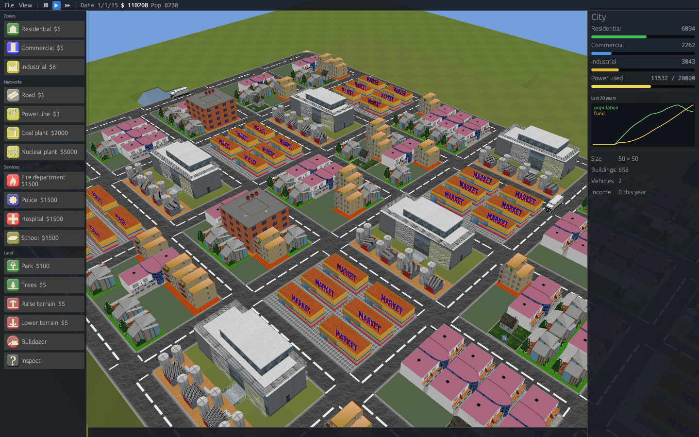
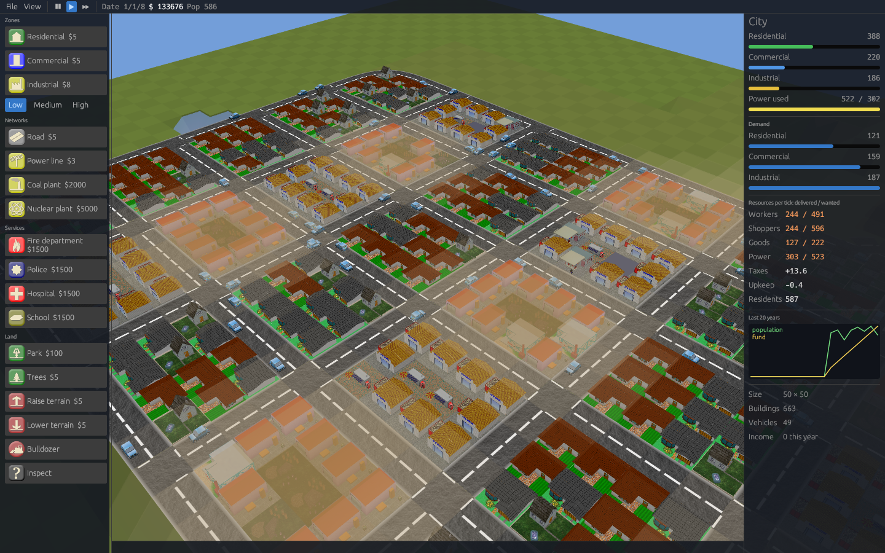
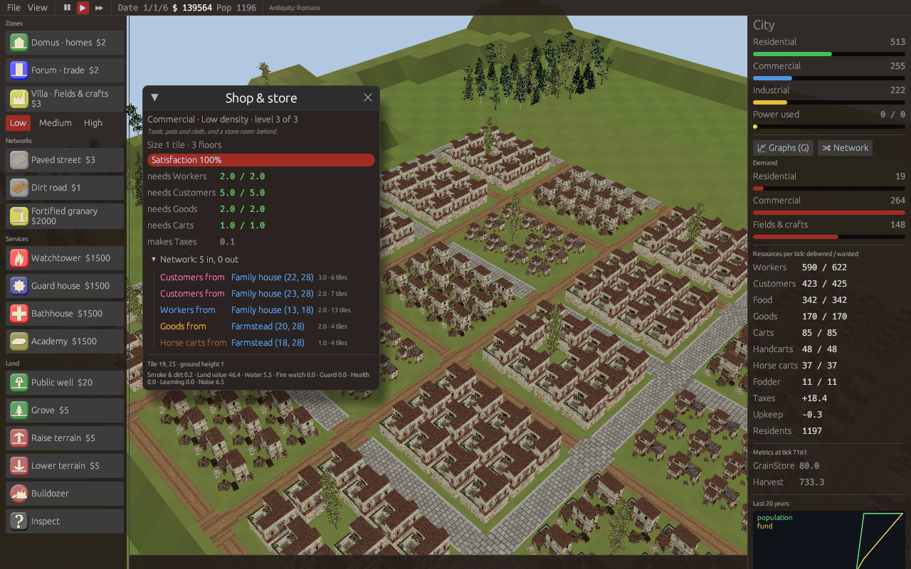

# citysim

A 3D city simulation in Rust, **derived from
[OpenCity](https://sourceforge.net/projects/opencity/)**, the GPL city
simulation written in C++/SDL/OpenGL by Duong Khang NGUYEN, Frédéric RODRIGO
and contributors (2003-2015). It started as a port of OpenCity's SVN trunk
(revision 480); see [NOTICE.md](NOTICE.md) for origins and credits.

**Website:** http://ingmmo.com/citysim/
Build residential, commercial and industrial zones, connect them with roads
and power, and watch them grow. The port keeps the original models, textures,
sounds and gameplay rules, and adds GeoJSON import so cities can be rebuilt
from OpenFantasyMap and OpenHistoryMap / OpenHistoricalMap data.



## Layout

| Crate | What it does |
|---|---|
| `opencity-core` | The simulation: terrain, buildings, zone growth, power grid, traffic, vehicles, budget, save files. No graphics, deterministic per seed. |
| `opencity-mapgen` | Terrain generator (diamond-square plus filters) and PNG heightmaps. |
| `opencity-assets` | Model catalog, AC3D `.ac` parser, TOML settings. |
| `opencity-geo` | GeoJSON / Overpass JSON import and GeoJSON export, rule-driven. |
| `opencity-cli` | Headless tool: create, simulate, render, import, export. |
| `opencity` | The game: macroquad (OpenGL) renderer, original GUI artwork, sound. |

`assets/` holds the original data files, unchanged. See
[docs/PORTING.md](docs/PORTING.md) for how the C++ code maps onto the crates
and which legacy behaviours changed.

## Downloads

Every push builds Linux (x86_64), macOS (Apple Silicon and Intel),
Windows (x86_64) and Android (arm64, armv7) packages; they appear as artifacts of the **release**
workflow run. Pushing a tag `vX.Y.Z` publishes them as a GitHub release.
Unpack the archive and run `opencity` (`opencity.exe` on Windows) from
inside the folder, next to `assets/`. To add the 0 A.D. buildings for the
ancient cultures, run `download-0ad-art.sh` (Linux), `download-0ad-art.command`
(macOS) or `download-0ad-art.cmd` (Windows) in the same folder. It downloads
about 115 MB from the official 0 A.D. repository and needs no Docker. The game
also does this once on first launch.

## Building

Everything builds and runs in a pinned Docker image (Rust 1.88.0 on Debian 12,
pinned by digest; exact crate versions in `Cargo.lock`):

```sh
scripts/dev.sh cargo test --workspace
scripts/dev.sh cargo build --release
scripts/dev.sh cargo clippy --workspace --all-targets
```

The image tag follows the Dockerfile hash, so editing `docker/Dockerfile`
triggers a rebuild. Build output lives in the `opencity-rs-target` volume
(`/target` inside the container).

To play, build natively (Rust 1.88+ and the X11/GL/ALSA development
packages listed in `docker/Dockerfile`) and run from the repository root:

```sh
cargo run --release -p opencity
cargo run --release -p opencity -- --demo --simulate-years 10
```

A headless screenshot works inside the container:

```sh
scripts/dev.sh xvfb-run -a -s "-screen 0 1280x800x24" \
  /target/debug/opencity --demo --simulate-years 15 --no-audio --screenshot screenshots/game.png
```

### Android

```sh
scripts/android.sh   # -> dist/android/citysim-<version>.apk
```

The APK is signed with a debug key, for sideloading. The packager
(`cargo-quad-apk`) embeds an old Cargo, so the script first writes a
compatible copy of the game crates (`cargo run -p xtask -- android-shim`).
On touch screens, drag with one finger to pan when no tool is selected. Use
two fingers to pan, pinch to zoom and twist to rotate. The menu is the
button under the speed control.

## Performance

Terrain, roads and buildings live in GPU buffers and are rebuilt only when
the city changes. Buildings are drawn with instancing: one draw call per
model, whatever the number of buildings. GPUs without instancing (some
Android devices) fall back to the simpler renderer. Measure with
`--bench-frames 120`, which prints the average frame time and a breakdown.

## Playing

| Input | Action |
|---|---|
| Left drag | Use the selected tool (zones and roads span the dragged area) |
| Right drag / Q, E / PageUp, PageDown | Rotate the view |
| Middle drag / arrows / WASD | Pan (hold Shift or Alt to go faster) |
| Wheel / + - / Insert, Delete | Zoom |
| Home, End | Tilt |
| R C I P L T X U J / | Residential, commercial, industrial, street (or the period's paved street), power line, trees, bulldozer, raise, lower, query |
| O | Turn the inspected plant or service a quarter (also ⟳ Turn in the inspector) |
| Space, F | Pause, fast forward |
| Esc | Drop the tool, or open the menu (new, load, save, quit) |

Roads come in four kinds that connect to each other:

| Road | Cost | Speed | Capacity | Width | Notes |
|---|---|---|---|---|---|
| Street | $5 | 1 | 1 | 1 tile, 2 lanes | Modern asphalt |
| Highway | $25 | 2.5 | 3 | 1.3 tiles, 4 lanes | Buildings cannot open onto it; trips between places near one take it |
| Paved street | $3 | 0.8 | 0.7 | ¾ tile | Cobbles and flagstones of older towns |
| Dirt road | $1 | 0.5 | 0.4 | ½ tile | Cheap, slow, narrow |

Dragging a road over another kind rebuilds it. Each age offers its own:
asphalt streets and highways today, paved streets and dirt roads before
the industrial age.

Plants and services (school, fire station, police, hospital…) snap to the
street: a new one turns to face the road beside it, and the placement
preview shows the turned footprint. Turn one by hand from the inspector.

Zones grow when they are powered, near a road, and near the two other zone
types. Power flows from plants through any chain of adjacent buildings,
roads and power lines. Taxes are collected monthly and paid each new year.

The desktop build uses an egui interface: menus, a tool palette with costs,
a city panel with history, open/save/import/export dialogs and a tile
inspector. The inspector names the building as the rules do, with its zone,
density and level, its size (tiles and floors), and for roads their speed,
capacity, lanes and cost. Android and `--classic-ui` use the original OpenCity artwork.

Settings live in `~/.config/opencity/settings.toml`; see
[docs/settings.example.toml](docs/settings.example.toml).

## Game rules (GlassBox)

Besides OpenCity's classic rules, cities can run on a **data-driven rules
set** in the spirit of SimCity's GlassBox engine:

* Zones (with low, medium and high densities) need and produce resources.
* Networks move resources: workers, shoppers and goods by road, power through the grid.
* Services use resources and cover the map with layers.

Two sets ship. [`glassbox.toml`](assets/rules/glassbox.toml) is a modern
city: power, cars, fuel. [`pre-industrial.toml`](assets/rules/pre-industrial.toml)
is a town of the past: people walk, carts carry trade (horse carts eat
fodder), fields and a granary feed the town, wells give water, and the
buildings are huts, cottages, row houses, insulae, market stalls, taverns,
coaching inns, caravanserais, quarries, foundries and craft halls. A new
city in an ancient, medieval or Renaissance age gets it by default.
Each road network lists its vehicles: what each one looks like, which road
kinds it may use, how fast it can go and what it carries. Modern towns get
cars, taxis and delivery trucks, drawn with the CC0 Kenney car kit. Towns of the past get people on foot, handcarts
and horse carts, and none of them may use a highway (see
[docs/RULES.md](docs/RULES.md#vehicles)).
Pooled resources build networks that are not on the map. People meeting
in cafés and taverns have ideas, which schools turn into research points,
and research projects unlock buildings and tools such as highways,
high-rises, nuclear plants, cobbled streets and the insula. Projects live
in tech tree files of their own (`assets/techs/`), with branches, tiers,
production bonuses and rival choices such as a free market or a guild
charter ([docs/RULES.md](docs/RULES.md#tech-trees)).
Behaviour can also be scripted in the **GlassBox rule language**: `unitRule`,
`mapRule`, `zoneRule` and `agentRule`, with the timestamped metrics of the
Extended GlassBox model by Costagliola, Montanari and Bellavista
([paper](https://cris.unibo.it/bitstream/11585/1033948/2/134951.pdf)). See
[`assets/rules/glassbox.gbx`](assets/rules/glassbox.gbx). Choose it under
**File > New city… > Rules**. See [docs/RULES.md](docs/RULES.md) and
[docs/GLASSBOX.md](docs/GLASSBOX.md).



## Skins

Skins re-dress the game for the **era** of a historical import or the
**world** of a fantasy map. They change colours, names, available tools,
icons and models. They are picked automatically from `--date` / the
GeoJSON `world`, or set with `--skin` and **View > Skin**. See
[docs/SKINS.md](docs/SKINS.md), which also assesses what a complete
per-era or per-world reskin needs.

**File > New city…** lets you pick an era (Antiquity, Middle Ages,
Renaissance, Industrial age, Modern) and a culture. The antiquity
cultures (Romans, Athenians, Gauls, Ptolemies, Han, Mauryas) use
[0 A.D.](https://play0ad.com) art (CC BY-SA 3.0, not committed).
`opencity-cli bake-0ad` converts it straight from the official 0 A.D.
repository at a pinned commit. It downloads only the files it needs, with no
Docker, git or Python. The game runs it in the background on first launch.
Use `--bake-0ad` to run it again, or `--no-auto-bake` to skip it.



## Maps from GeoJSON

```sh
# OpenHistoricalMap via Overpass, rebuilt as it was in 1600
scripts/dev.sh /target/debug/opencity-cli import-geojson data/ohm-bologna-center.json --date 1600 -o bologna.ocsave.json
# A fantasy world in planar map units, with its own tag vocabulary
scripts/dev.sh /target/debug/opencity-cli import-geojson world.geojson --rules my-rules.toml -o world.ocsave.json
# Back to GeoJSON
scripts/dev.sh /target/debug/opencity-cli export-geojson bologna.ocsave.json -o bologna.geojson
```

The game opens the same inputs directly with `--geojson FILE [--date YEAR] [--rules FILE]`.
Roads are drawn as smooth ribbons along their tiles: L-turns become curves
and the zig-zags that diagonal streets rasterise to become flowing diagonals.
Street junctions keep the original crossing models; each kind of road has
its own width and surface.
See [docs/GEOJSON.md](docs/GEOJSON.md).

## License

GPL-2.0-or-later, like OpenCity. Artwork and sounds are OpenCity's (see
[NOTICE.md](NOTICE.md) and `AUTHORS`). `data/ohm-bologna-center.json` is OpenHistoricalMap
data (CC0).
