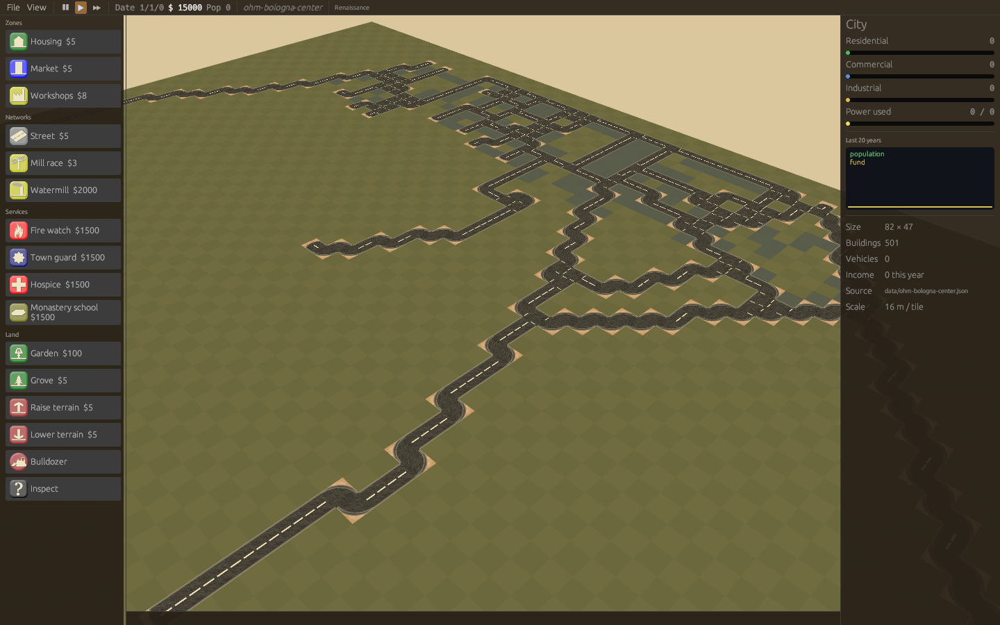

# citysim

A 3D city simulation in Rust, **derived from
[OpenCity](https://sourceforge.net/projects/opencity/)**, the GPL city
simulation written in C++/SDL/OpenGL by Duong Khang NGUYEN, Frédéric RODRIGO
and contributors (2003-2015). It started as a port of OpenCity's SVN trunk
(revision 480); see [NOTICE.md](NOTICE.md) for origins and credits.
Build residential, commercial and industrial zones, connect them with roads
and power, and watch them grow. The port keeps the original models, textures,
sounds and gameplay rules, and adds GeoJSON import so cities can be rebuilt
from OpenFantasyMap and OpenHistoryMap / OpenHistoricalMap data.


## Layout

| Crate | What it does |
|---|---|
| `opencity-core` | The simulation: terrain, buildings, zone growth, power grid, traffic, vehicles, budget, save files. No graphics, deterministic per seed. |
| `opencity-mapgen` | Terrain generator (diamond-square plus filters) and PNG heightmaps. |
| `opencity-assets` | Model catalog, AC3D `.ac` parser, TOML settings. |
| `opencity-geo` | GeoJSON / Overpass JSON import and GeoJSON export, rule-driven. |
| `opencity-cli` | Headless tool: create, simulate, render, import, export. |
| `opencity` | The game: macroquad (OpenGL) renderer, original GUI artwork, sound. |

`assets/` holds the original data files, unchanged. See
[docs/PORTING.md](docs/PORTING.md) for how the C++ code maps onto the crates
and which legacy behaviours changed.

## Downloads

Every push builds Linux (x86_64), macOS (Apple Silicon and Intel),
Windows (x86_64) and Android (arm64, armv7) packages; they appear as artifacts of the **release**
workflow run. Pushing a tag `vX.Y.Z` publishes them as a GitHub release.
Unpack the archive and run `opencity` (`opencity.exe` on Windows) from
inside the folder, next to `assets/`.

## Building

Everything builds and runs in a pinned Docker image (Rust 1.88.0 on Debian 12,
pinned by digest; exact crate versions in `Cargo.lock`):

```sh
scripts/dev.sh cargo test --workspace
scripts/dev.sh cargo build --release
scripts/dev.sh cargo clippy --workspace --all-targets
```

The image tag follows the Dockerfile hash, so editing `docker/Dockerfile`
triggers a rebuild. Build output lives in the `opencity-rs-target` volume
(`/target` inside the container).

To play, build natively (Rust 1.88+ and the X11/GL/ALSA development
packages listed in `docker/Dockerfile`) and run from the repository root:

```sh
cargo run --release -p opencity
cargo run --release -p opencity -- --demo --simulate-years 10
```

A headless screenshot works inside the container:

```sh
scripts/dev.sh xvfb-run -a -s "-screen 0 1280x800x24" \
  /target/debug/opencity --demo --simulate-years 15 --no-audio --screenshot screenshots/game.png
```

### Android

```sh
scripts/android.sh   # -> dist/android/citysim-<version>.apk
```

The APK is signed with a debug key, for sideloading. The packager
(`cargo-quad-apk`) embeds an old Cargo, so the script first writes a
compatible copy of the game crates (`cargo run -p xtask -- android-shim`).
On touch screens, drag with one finger to pan when no tool is selected. Use
two fingers to pan, pinch to zoom and twist to rotate. The menu is the
button under the speed control.

## Playing

| Input | Action |
|---|---|
| Left drag | Use the selected tool (zones and roads span the dragged area) |
| Right drag / Q, E / PageUp, PageDown | Rotate the view |
| Middle drag / arrows / WASD | Pan (hold Shift or Alt to go faster) |
| Wheel / + - / Insert, Delete | Zoom |
| Home, End | Tilt |
| R C I P L T X U J / | Residential, commercial, industrial, road, power line, trees, bulldozer, raise, lower, query |
| Space, F | Pause, fast forward |
| Esc | Drop the tool, or open the menu (new, load, save, quit) |

Zones grow when they are powered, near a road, and near the two other zone
types. Power flows from plants through any chain of adjacent buildings,
roads and power lines. Taxes are collected monthly and paid each new year.

The desktop build uses an egui interface: menus, a tool palette with costs,
a city panel with history, open/save/import/export dialogs and a tile
inspector. Android and `--classic-ui` use the original OpenCity artwork.

Settings live in `~/.config/opencity/settings.toml`; see
[docs/settings.example.toml](docs/settings.example.toml).

## Skins

Skins re-dress the game for the **era** of a historical import or the
**world** of a fantasy map. They change colours, names, available tools,
icons and models. They are picked automatically from `--date` / the
GeoJSON `world`, or set with `--skin` and **View > Skin**. See
[docs/SKINS.md](docs/SKINS.md), which also assesses what a complete
per-era or per-world reskin needs.



## Maps from GeoJSON

```sh
# OpenHistoricalMap via Overpass, rebuilt as it was in 1600
scripts/dev.sh /target/debug/opencity-cli import-geojson data/ohm-bologna-center.json --date 1600 -o bologna.ocsave.json
# A fantasy world in planar map units, with its own tag vocabulary
scripts/dev.sh /target/debug/opencity-cli import-geojson world.geojson --rules my-rules.toml -o world.ocsave.json
# Back to GeoJSON
scripts/dev.sh /target/debug/opencity-cli export-geojson bologna.ocsave.json -o bologna.geojson
```

The game opens the same inputs directly with `--geojson FILE [--date YEAR] [--rules FILE]`.
See [docs/GEOJSON.md](docs/GEOJSON.md).

## License

GPL-2.0-or-later, like OpenCity. Artwork and sounds are OpenCity's (see
[NOTICE.md](NOTICE.md) and `AUTHORS`). `data/ohm-bologna-center.json` is OpenHistoricalMap
data (CC0).
