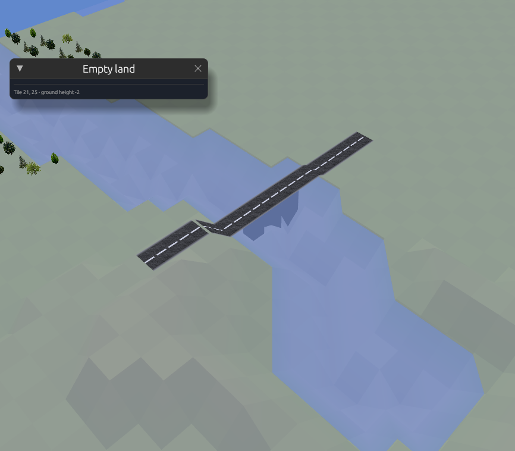
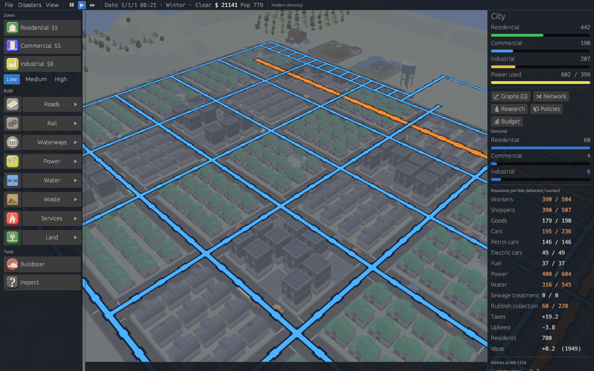
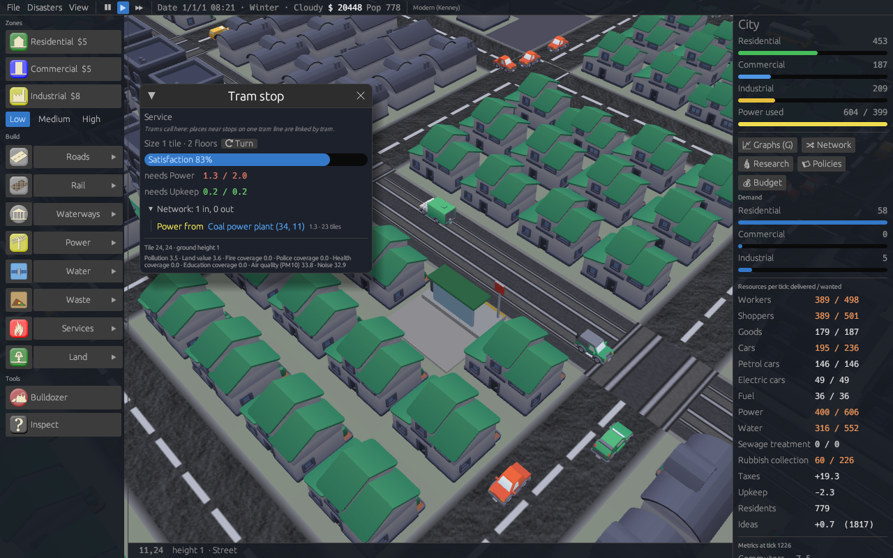
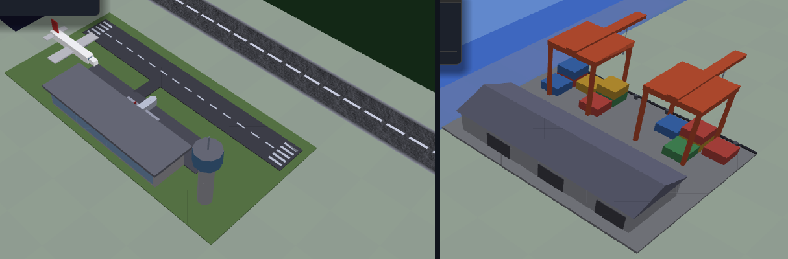
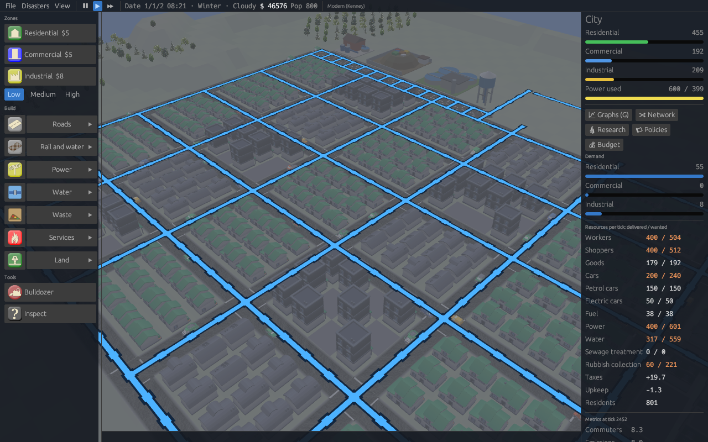

# Playing citysim

A guide to building and running a city. For the file formats behind the
game see [RULES.md](RULES.md); for the documentation index see
[README.md](README.md).

## Starting a city

- **File > New city…** opens the new city dialog:
  - **Map:** width, length, relief, water, shape, rivers, trees and seed (🎲 picks a random one). Rivers run from the high ground down to the sea, a lake or the edge of the map; roads, tracks and power lines cross them, and a road or track over water is a **bridge**, at three times the price of the tile. Boats pass under bridges.
  - **Era:** Antiquity, Middle Ages, Renaissance, Industrial age or Modern, plus a culture for antiquity.
  - **Rules:** **Classic** is OpenCity's original growth rules. **GlassBox** is the data-driven engine. Cities before 1800 default to the pre-industrial GlassBox rules.



- **File > Import GeoJSON…** builds a city from OpenHistoryMap, OpenHistoricalMap or OpenFantasyMap data (see [GEOJSON.md](GEOJSON.md)).
- **From the command line:** `--demo` starts a demo town and `--load FILE` opens a saved one.

## In the browser

The same game runs at <http://ingmmo.com/citysim/play/>, with these
differences:

- **Saves** live in the browser's local storage, not in files. File > Save
  keeps one city under the name shown; *Save as…* with another name keeps
  several. Clearing the site's data loses them, and a private window forgets
  them when closed. Very large cities may not fit (browsers allow about 5 MB).
- **Exports** (GeoJSON, CSV) are downloaded instead of written to a folder.
- **Regions** work: File > New region… keeps the region and its towns in the
  browser's storage, Open region… lists them, and Join region server… reaches
  a server over HTTP (the page is served over plain HTTP, so an `http://`
  server address works; the server answers browsers from any origin). Add
  `?join=http://host:8077&player=ada&slot=0,0` to the address to join at once.
- **Options** go in the address: `play/?demo&game-rules=glassbox&skin=modern`
  is `--demo --game-rules glassbox --skin modern`; `?seed=7&size=80x80` works
  the same way.
- The ancient cultures have no buildings (their art is installed by the
  desktop game); the other skins are all there.

## Controls

The interface is drawn at the screen's pixel density, so it keeps its
size on phones and high-resolution screens (on narrow screens the City
panel starts hidden, to leave room for the map). **View > Size of the
interface** makes it Large or Huge on top of that, and `--ui-scale 1.5`
(in the browser, `?ui-scale=1.5`) sets it from the start.

| Input | Action |
|---|---|
| Left drag | Use the selected tool. Zones and roads cover the dragged area. |
| Right drag, Q / E, PageUp / PageDown | Rotate the view |
| Middle drag, arrows, WASD | Pan (hold Shift or Alt to go faster) |
| Wheel, + / −, Insert / Delete | Zoom |
| Home / End | Tilt |
| R, C, I | Residential, commercial, industrial zone |
| P | The street of the age: asphalt, else paved, else dirt |
| L, T | Power line, trees |
| X | Bulldozer |
| U, J | Raise, lower terrain |
| / | Inspect a tile |
| N | Drop the tool |
| O | Turn the inspected plant or service a quarter |
| G | GlassBox graphs |
| V | Resource network on the map |
| B | Underground view: water pipes and metro tunnels |
| Space, F | Pause, fast forward |
| Esc | Drop the tool, or open the menu (new, load, save, quit) |

**On phones and other touch screens:**
- With no tool selected, drag with one finger to pan.
- Two fingers pan, pinch zooms and twist rotates.
- The menu is the button under the speed control.

## Building

- **The sidebar:** zones and their density at the top. Below them, each
  family of tools is one row: **Roads, Rail, Waterways, Power, Water,
  Waste, Services, Amenities, Land**. The icon on the left picks the last tool you used
  from that family; the name opens a submenu beside the sidebar with all of
  them, with their prices. A row shows the tool in use. Bulldozer and
  Inspect stay at the bottom.
- **Zones** grow when they have a road nearby and power (in the modern rules), and are close to the other two zone types.
  - Under GlassBox rules, pick a **density** (low, medium, high) before zoning. Denser zones cost more and grow bigger buildings.
- **Roads** come in four kinds that connect to each other. Each era offers its own.

  | Road | Cost | Speed | Capacity | Notes |
  |---|---|---|---|---|
  | Street | $5 | 1 | 1 | Modern asphalt |
  | Highway | $25 | 2.5 | 3 | Buildings cannot open onto it |
  | Paved street | $3 | 0.8 | 0.7 | Cobbles of older towns |
  | Dirt road | $1 | 0.5 | 0.4 | Cheap, slow, narrow |

  | Railway | $20 | 4 | 4 | Trains only; roads cross it at level crossings |
  | Tram line | $15 | 1 | 1 | A street with tram tracks: cars use it too |

  Dragging a road over another kind rebuilds it, but roads leave track alone.
- **Railways:** lay track with the Railway tool, then put a **Railway
  station** next to it, near a street. Places within 8 tiles of a station
  reach places near every other station on the same line, even in another
  town no road joins. Trains run between the stations. In the modern rules
  rail waits for the **Railways** research project; there is none before 1800.
- **Buses and trams** (modern GlassBox rules, after the **Public
  transport** research project):
  - **Trams:** drag the **Tram line** tool (Rail) along streets to lay
    tracks in them. Cars still drive there. Put **Tram stops** beside the
    tram street. Places within 8 tiles of a stop reach places near every
    other stop on the same line, at twice street speed.
  - **Buses:** put **Bus stops** (Roads) beside any streets. Places near
    two bus stops on one street network reach each other at 1.5 times
    street speed.
  - **Metro** (after the **Metro** research project): drag the **Metro
    line** tool (Rail) to bore tunnels under anything: streets, buildings,
    open land. Put a **Metro station** over the tunnel or right beside it.
    Stations on one run of tunnels link the places around them at three
    times street speed, and traffic never slows them. The underground view
    (**B**) shows the tunnels in orange beside the blue water pipes; there
    the bulldozer digs up both.

    
  - Busy streets slow trips by car (inspect a road to see how full it
    is). Trams and trains run on their own tracks, buses feel half the
    traffic, and highways bypass it.
  - A ride costs the walk to and from the stops and 3 tiles' worth of
    boarding, so it pays for longer trips: people reach work and shops
    farther away than they could drive to. Trams and buses run between
    the stops on the map.

  
- **Plants and services** (power plants, fire stations, police, hospitals, schools, wells…):
  - **Placing:** a new one turns to face the street beside it, and the preview shows the footprint it will take.
  - **Turning:** inspect it and press **⟳ Turn**, or **O**. Long buildings swap their footprint when turned.
- **Ports:** a **Seaport** (on the shore, like a harbour) and an **Airport** trade with the rest of the world under GlassBox rules: the seaport brings in the goods and fuel the city lacks and ships out what it cannot sell; the airport flies in tourists for the shops and some freight. Both need research (*Ports*, *Aviation*), workers and power, and pay for what they import at the resource's price. Inspect one to see what went through. Under classic rules they are landmarks.

  
- **Harbours and canals:** a **Harbour** goes on dry land with water within
  2 tiles, past the sloping shore. Places near harbours on the same lake,
  river, coast or canal trade with each other, carried by ships (rowing and
  sailing boats before 1800, at a **Quay**). The **Canal** tool digs empty
  land below the water line to join waters or bring them to a town.
- **Water** (GlassBox rules): bigger buildings want water, and dense
  ones want their sewage treated. Water reaches them through pipes laid
  underground.
  - **Pumping station:** pumps water into the mains. It needs power and
    clean ground around it.
  - **Water tower:** a small store of water that needs no power.
  - **Water treatment plant:** treats the sewage of the buildings on its
    mains; nobody wants to live next to one.
  - **Water pipe:** drag it like a road. Pipes go underground, under
    streets, buildings or open land, and cost the same everywhere. A
    building gets water from a pipe under it, or under the street beside
    it, and passes it on to the buildings it touches.

  **Underground view:** press **B** (or View > Underground), or pick
  any Water tool, to fade the city and see the pipes. In this view the
  bulldozer digs up pipes and leaves everything above them; outside it,
  the bulldozer never touches pipes. The inspector says when a water
  main runs under a tile. What belongs to the mains stands out of the
  faded city under a beacon: pumping stations in blue, water towers in
  cyan, treatment plants in green. Metro stations glow orange (bus and
  tram stops stay dim). With a water tool in hand the metro tunnels
  fade, and with a metro tool the mains do.

  

  Level-2 buildings need water. Medium and high density buildings from
  level 2 also need sewage treatment.
- **Waste** (GlassBox rules): rubbish trucks go out from these buildings
  to collect from the buildings around them. Level-3 buildings need
  collection.
  - **Landfill:** cheap, but it smells and lowers land value nearby.
  - **Recycling centre:** collects less, but sends materials back to the
    shops as goods.
  - **Incinerator:** burns rubbish and makes some power, with smoke.

  Before 1800 the dump is a **Midden**, and handcarts take the refuse of
  the biggest houses there; wells still give the water.
- **Disasters:** fires, floods and epidemics (great fires and plague
  before 1800) strike now and then. Fire coverage protects against fire and
  health coverage against sickness; floods hit low ground by the water. A
  notice says where it struck and how many buildings it hit, and fire trucks
  head there. The **Disasters** menu switches them off or sets one off by hand.
  - **A fire burns for a while.** Buildings on fire show flames, smoke and a
    flame mark over the roof. Each stands for some twenty ticks; until then
    fire coverage may put it out and save it, and the fire may pass to the
    buildings next door, less easily where coverage is good. With no fire
    station in reach, what burns is lost, and a whole block can go.
    Bulldozing the neighbours makes a firebreak. When the last fire is out
    a message counts the buildings lost and saved.
  - Flooded buildings carry a wave mark and the ill a red cross, for as
    long as it lasts. The inspector says what a building suffers from.
- **Amenities** (their own row in the sidebar): places people go to. They
  take visitors, who are the shoppers looking for somewhere to go, raise
  the land value around them, and need staff, power and upkeep.

  | Amenity | Size | Gives | Needs research |
  |---|---|---|---|
  | Museum | 3 × 3 | 1.5 ideas a tick, land value | no |
  | Archaeology museum | 3 × 3 | 2 ideas, land value, some education around it | Cultural institutions |
  | Modern art museum | 3 × 3 | 3 ideas, more land value | Cultural institutions |
  | Opera house | 4 × 3 | 2 ideas, the most land value, over the widest area | Cultural institutions |
  | Stadium | 6 × 5 | takings (taxes), land value far around; noise next door, 120 visitors and 40 cars a tick | Mass entertainment |
  | Shopping mall | 5 × 4 | the taxes of a skyscraper, no upkeep; wants 110 shoppers, goods, and parking | Mass entertainment |

  Ideas feed the schools (see Research). Before 1800 there are an **Arena**
  and a **Theatre** (after *Spectacles*) and no museums or mall.
- **Services cover what they can reach by road.** Fire, police and health
  coverage spreads along the streets from the building, so a station on a
  street cut off from a neighbourhood does not protect it. Fire trucks,
  police cars and ambulances (the watch and guards on foot before 1800) go
  out to the buildings they cover.
- **Locked tools** are greyed out until research unlocks them; their tooltip names the project.

## The city panel

The right-hand panel shows:
- zone sizes and power;
- demand for each zone (GlassBox), which comes from what the city lacks: jobs left open, shoppers and goods with nowhere to go;
- what each resource delivered against what was wanted (orange when short), with taxes, upkeep and pools such as ideas;
- metrics from the rule scripts and the last 20 years of population and funds.

Click any building with the inspect tool (/) to see:
- its zone, density and level, size and floors;
- its satisfaction;
- what it needs and makes, where its supplies come from and what it lacks;
- the map layers on its tile.

## Scenarios

**File > New scenario…** starts a game with a map, rules, money and goals.
The 🎯 **Goals** window (in the City panel) shows how each goal is going.
`--scenario ID` starts one from the command line. A **pack** goes further:
it seals a scenario with its skin and rules, as a game of its own
(`--pack ID`; see [PACKS.md](PACKS.md)).

| Scenario | Start | Goals |
|---|---|---|
| First town | A lakeside valley, modern rules, $30,000 | 2,000 people within 6 years, research motorways within 8, never in debt |
| Rail baron | A long hilly map, $60,000 | Research railways within 4 years, 3 stations within 8, 4,000 people within 12, never in debt |
| Bologna, 1600 | The centre of Bologna from OpenHistoricalMap in 1600, pre-industrial rules, Renaissance dress | Printing within 15 years, 200 food a day within 5, never in debt |

**How goals work:**
- A goal with a deadline must be reached within its years. Once reached, it
  stays reached.
- An "all game long" goal must hold every month.
- You win when every goal is reached and every all-game goal holds. You lose
  when a deadline passes or an all-game goal breaks.

**Writing your own:** a scenario is a TOML file in `assets/scenarios/`,
listed in `index.toml`.

```toml
id = "my-town"
name = "My town"
description = "What the player is asked to do."

[start]                      # a generated map, or geojson = "…" with date = "…"
width = 64
length = 64
seed = 7
relief = "hill"              # plain, hill, mountain
water = "coast"              # dry, lake, coast
rules = "glassbox"           # or pre-industrial; none for classic
skin = "industrial"          # optional
fund = 20000
research_all = false         # demo = true lays out the demo town

[[goal]]
name = "5,000 people"
metric = "population"        # population, fund, buildings, research:<id>,
at_least = 5000              # unit:<id>, structure:<kind>, produced:<res>, unmet:<res>
within_years = 10            # or always = true; at_most for upper bounds
```

## Regions

A region is a grid of neighbouring cities, played one at a time, that trade
across their borders.

- **File > New region…** picks a name, the number of cities across and down,
  the map size and the rules, then founds the first town. **File > Open
  region…** opens one; regions live next to your saves in `regions/`.
  `--region FOLDER` opens or creates one from the command line.
- **The 🗺 Region window** shows the grid. Click a town to play it, which
  saves the open one, or found a new one in an empty slot.
- **Border crossings:** neighbours trade through a road, track, metro tunnel or power line
  that reaches their shared edge, on both sides. The window shows each edge:
  ✔ trading, ✖ a crossing is missing, · no neighbour.
- **Building one:** take a road, track or power line to the edge of the map
  and it runs on into the neighbour. The same street, railway or line
  appears on the neighbour's map at the matching place on the shared edge,
  free of charge, and a message says where it leads. In a region you play
  alone it appears when you next open that town (or found it). Online it
  appears in the other player's game at their next monthly update.
- **Border gates** stand where each crossing leaves the map: green when the
  neighbour has the crossing too, amber while it waits for one, grey at
  the edge of the region.
- **Their crossing, your map:** a crossing that arrives from a neighbour never
  replaces what you built on that edge tile; a message says it could not
  cross. Bulldoze one you don't want and it stays gone.
- **On a lone map** (no region), a road built to the edge leads nowhere, and
  a message says so: there is no region server, so no town lies beyond.
- **Monthly trade:** each month the open town buys what it lacks from
  neighbours with a surplus and sells what it has left over: workers
  commuting, shoppers, goods, fuel and power (food before 1800). Imports fill
  unmet needs and cost money; exports earn it. The window lists the deals.
- **Crossings carry the trade:** each crossing joined on both sides is a
  gate, a node of your town's network. Commuters, shoppers and lorries drive
  in from the edge to the nearest places that need them, and out from the
  places with something left over. Power runs in and out along lines and
  streets. Trains bring what they carry to the stations on the crossing's
  line. A crossing your streets, lines or stations don't reach carries
  nothing, and you only pay for what actually came in.
- **Commuting has a limit:** people and lorries go no further from the
  border than they would inside the town (traffic counts too). Transit
  that crosses the border carries them further: a **tram street**, a street
  with **bus stops**, or a **metro tunnel** taken to the edge links the
  places near its stops to the crossing. A metro tunnel at the edge is a
  crossing of its own; the neighbour's end is bored for free. The window shows
  what went through each crossing last tick, against what was agreed.
- **Waiting towns:** neighbours keep the summary they had when you last left
  them, until you play them again.

### Playing a region with others

One player hosts a region server; each player plays one town of it in their
own game.

```sh
# the host (any machine the players can reach)
opencity-cli region-server --dir my-region --listen 0.0.0.0:8077 --name Emilia --across 3 --down 3
```

- **Joining:** each player picks **File > Join region server…** and enters
  the server's address, a name and a free slot. You can also start the game
  with `--join http://host:8077 --player ada --slot 1,0`, or in the browser
  open `play/?join=http://host:8077&player=ada&slot=1,0`. Players on the
  desktop and in the browser share one region.
- **Your town** saves on your own machine. Each month your game fetches the
  other towns' summaries, agrees trade with the neighbours, takes in their
  ideas, and sends your town's summary back.
- **The Region window** shows who plays which town. Online you play only
  the town you claimed.
- **No security:** the server keeps `region.json` and the players' tokens in
  its folder. It has no passwords or encryption, so play with people you trust,
  on a network you trust.

### Shared culture

Pooled resources marked `shared` spread across the region. **Ideas** do in
both rule sets: every month each town takes in a tenth of the ideas the other
towns of the region make, so a town of thinkers helps its neighbours'
research. This happens in regions played alone and online.

### Region-wide research

Some projects are too big for one town and are marked **region-wide** in the
Research window. **Nuclear fusion** is the one in the modern tree.

- Every town of the region can pay into the project. What the other towns
  have paid counts, and the window shows their share.
- Once one town finishes it, every town of the region has it: the others
  get the news the next time they are played, or within a month online.
- Towns learn of each other's payments when a town is saved (a region
  played alone) or once a month (online).
- A town on its own pays the lot.

## Power plants

Under GlassBox rules a plant's power goes to whatever its network reaches.

| Plant | Size | Cost | Power | Staff | Upkeep per tick | Notes | Research needed |
|---|---|---|---|---|---|---|---|
| Coal plant | 5 × 3 | $2,000 | 400 | 10 | 0.4 | pollutes around it | none |
| Solar farm | 4 × 4 | $1,800 | 120 | 1 | 0.1 | clean; little power for the land it takes | Photovoltaics |
| Nuclear plant | 6 × 6 | $5,000 | 1,200 | 25 | 1.6 | clean | Nuclear fission |
| Fusion plant | 7 × 6 | $40,000 | 6,000 | 40 | 5 | clean; enough to sell to the neighbours | Nuclear fusion (region-wide) |

Nuclear fusion costs 120,000 research points, fifteen times nuclear fission:
about four years of one university's work. It needs Nuclear fission and
Computing first. The solar farm and the fusion plant need GlassBox rules and
are not built before 1800.

## Research

Under GlassBox rules, ideas and research unlock buildings and tools:

1. People meeting in cafés, shops and malls (taverns, inns and market squares before 1800) have **ideas**, which go into a city-wide pool.
2. Schools (academies) turn ideas into **research points**. Higher schools do it faster and get more out of each idea:

   | Building | Research per tick | Ideas used | Staff | Unlocked by |
   |---|---|---|---|---|
   | School | 2 | 1 | 6 | from the start |
   | High school | 7 | 3 | 14 | Secondary education |
   | University | 24 | 8 | 40 | Higher education (after Secondary education) |

   The university is a campus of 7 × 5 tiles (5 × 4 before 0.2.58: those already built keep their size and work the same). Museums, the opera house and the mall add ideas for the schools to work on.

   A university needs a town with cafés and restaurants enough to feed it ideas; short of them it works at part speed. Before 1800 the **Studium** (after *Studium generale*) makes 6 points to the academy's 1.5.
3. In the **🔬 Research** window, pick a project. It draws on the pools each tick until it is paid for.

The window groups projects by branch and sorts them by tier, and shows for each one:
- ✔ done, ▶ in progress, ○ available, 🔒 waiting for another project, ✖ ruled out;
- its cost, what it unlocks and its production bonuses.

Some projects are **rivals**: finishing one rules out the others for good.
- Modern: a **service economy** or **industrial policy**.
- Before 1800: a **free market** (market squares) or a **guild charter** (craft halls).

Without the window (classic interface, Android), the city researches projects in order by itself. Demo towns start with everything researched.

## Taxes and policies

The **📜 Policies** window sets:
- **Tax rates.** Each tax has a default rate and a range.
  - Above the default, the zones paying it bring in more, but they want to grow less and their buildings are less satisfied.
  - Below the default, they grow faster for less income.
  - The window shows the effect on income, demand and satisfaction.
- **A stance for each policy.** Every policy has a default stance and alternatives with trade-offs: production bonuses, more or less demand, happier or unhappier people, and a running cost or income.
  - Some stances wait for research. Atomic age needs fission, Festivals the free market, Long hours the guild charter.

| Rules | Taxes | Policies |
|---|---|---|
| Modern | Property, sales, business (9 %) | Transport, Energy, Education, Growth |
| Pre-industrial | Hearth tax, market tolls, guild dues | Labour, Provision, Gates |

## Seeing the city

- **View > Data layer:** pollution, land value, air quality, noise, water, and fire, police, health and education coverage, drawn over the map.
- **🔀 Network (V):** arcs from each sender to each receiver, coloured by resource. You can:
  - filter by resource and hide small flows;
  - list the busiest links and the biggest shortages;
  - click a building to see only its flows.
- **📡 Sensors:** inspect any tile (`/`) and leave a sensor there. At a crossing it counts the traffic driving past, by what it carries; on a building, what arrives and leaves; anywhere, pollution, noise and the other maps. Read it in the inspector, plot it in the graphs, or save it as a CSV file. **View > Sensors** lists them.
- **Rush hours:** with **View > Day and night** on, traffic follows the clock. People leave home around 8 and come back around 18, shoppers go out late in the morning and after work, deliveries run by day, and the streets are empty at night. Hospitals, police and fire stations, and one shop or factory in twenty, work round the clock in three shifts.
- **📈 Graphs (G):** every series the engine samples (demand, flows, satisfaction, layers, metrics, funds, growth). Zoom, smooth, normalise, compare and export CSV.
- **Vehicles:** cars, taxis and trucks in modern towns (Kenney car kit); people, handcarts and horse carts before 1800. What travels where follows the rules: no cars in the Middle Ages, no carts on the highway.
- **View > Skin:** re-dresses the city for an era or a world (see [SKINS.md](SKINS.md)).

## Day and night, seasons and weather

- **Day and night:** the light turns once a game month, through dawn, noon,
  a warm dusk and a blue night. (A game day passes in under two seconds, so a
  daily cycle would only flicker.) The top bar shows the hour, the season and
  the weather.
- **Seasons:** the ground greens in spring, turns gold in autumn and goes
  white in winter.
- **Weather:** it changes weekly with the season's odds: clear, cloudy, rain
  and storms, and snow in winter. Rain and snow fall around you.
- **Effects on disasters:** storms make fires likelier, as does dry summer.
  Rain and snow damp them down. Rain and storms swell floods, and so does
  spring. Sickness spreads more in winter.
- **Switching it off:** **View > Day and night, weather** turns the light,
  ground colours and falling rain and snow off. The weather's effect on
  disasters stays.

## Budget

The **💰 Budget** window, in the City panel, shows where the money goes.

- **Last month and this month so far, by line:**
  - taxes, per tax;
  - upkeep, per kind of service;
  - policies, trade sales and purchases;
  - loans, and the family (if called);
  - under classic rules, maintenance and the yearly taxes.
- **Service funding:** a slider per kind of service from 0 to 150%. It
  scales both what the service costs and how strongly it covers the city,
  so half-funded fire stations cost half and protect less.
- **Loans:** borrow $10,000, $50,000 or $200,000 at 6% a year, repaid monthly
  over five years, with three loans at most.

The MCP server has a `budget` tool with the same lines, funding and loans.

## Cheats

**Ctrl+Shift+C** opens the cheat box, as in SimCity 3000.

- **`CallCousinVinnie`** wires **$1,000,000** to the city. But Cousin Vinnie
  has family, and they move in:
  - **Protection money:** every month they collect up to $20,000, scaled by
    their hold on the city.
  - **Crime:** police coverage falls everywhere while they are in town.
  - **Arson:** now and then a block burns ("Somebody didn't pay").
  - **Driving them out:** each police station loosens their hold month by
    month, and with enough stations the family packs up and leaves. Calling
    Vinnie again tightens their grip.

The MCP server has a `cheat` tool too.

## Saving and sharing

- **Saving:** **File > Save** writes a `.ocsave.json`. Saves keep the rules, research, tax rates, stances, building facings and vehicles.
- **Exporting:** **File > Export GeoJSON…** writes the city back in the coordinates it was imported from.
- **Headless:** `opencity-cli` creates, simulates, renders, imports and exports cities without a window. `opencity-cli simulate --metrics out.csv` exports every series.
