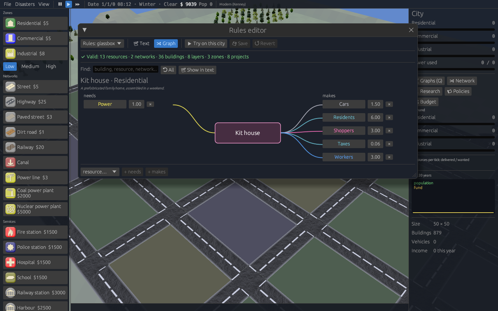
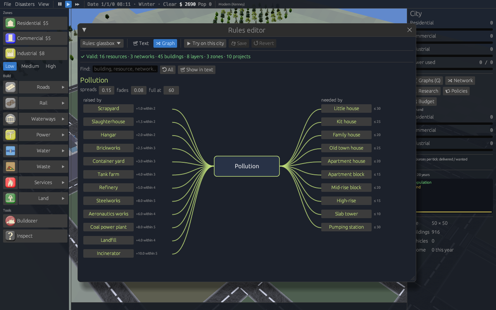

# Game rules: the GlassBox engine

New cities can run on the **classic OpenCity rules** or on a **rules set**:
a data file describing everything the city simulates, in the spirit of the
GlassBox engine of SimCity (2013). Pick it in **File > New city… > Rules**,
or with `--game-rules glassbox` (game and CLI). The shipped set is
[`assets/rules/glassbox.toml`](../assets/rules/glassbox.toml); copy it, edit it, and list
your file in `assets/rules/index.toml`.

## The model

Buildings are **units**. Each one:

* **produces** resources every tick, scaled by its **satisfaction**;
* **needs** resources every tick; what arrives decides its satisfaction;
* **sends** its stock of some resources to units that need them;
* has **outlets**: sent resources that must find takers (homes want jobs for
  their workers and shops for their shoppers);
* **emits** into map layers (pollution, land value, service coverage);
* **requires** layer values at its tile (each unmet condition halves its satisfaction).

**Satisfaction** is the share of a unit's needs that was met, each need
counted by its amount times the resource's `weight` (1 unless set: in the
modern rules power weighs 4, water 2, parking 0.5, upkeep 25). An outlet
counts like a need for takers of what was made, times how much it matters:

```toml
[[unit]]
id = "house_1"
produce = { residents = 4, workers = 2, shoppers = 2, taxes = 0.04, car = 1 }
needs = { power = 1 }
sends = ["workers", "shoppers", "car"]
outlets = { workers = 1, shoppers = 0.5 }   # jobs matter, shops half as much
```

A need or an outlet met by less than half **starves** the unit: its
satisfaction is cut further, down to a quarter when nothing comes at all (an
outlet weighing 0.5 cuts half as deep). So a home without power, a shop
without customers, a workshop without workers or a home whose people find
no work all fall below `level_down` and empty; a home with work but no shop
within reach gets by, and never grows.

**Resources** say how they travel:

| `transport` | Moves | Examples |
|---|---|---|
| `agents` | Along a network, from the nearest senders to receivers, within `max_trip` tiles. A sample of trips is shown as vehicles. | workers, shoppers, goods |
| `grid` | Instantly within each connected part of a network; shared proportionally when short. | power |
| `city` | Into or out of the treasury. | taxes, upkeep |
| `local` | Stays in the unit, used for statistics. | residents |
| `pool` | Into one city-wide stock that keeps from tick to tick. Needs draw on it and research spends it. | ideas, research points |

**Kinds** (subtypes) split an `agents` or `grid` resource into variants that
fill the same slots but weigh on different networks. `car` with kinds
`gasoline` and `electric` becomes three resources: `car`, `car.gasoline` and
`car.electric`.

* **Slots.** A need for `car` is a slot that either kind fills, from the
  nearest sender with any kind in stock. A need for `car.electric` takes only
  electric cars, and is served before slots.
* **Production.** A unit that produces `car` makes its kinds by their
  `share`. A unit can also produce a kind directly.
* **Secondary impacts.** `uses` lists resources a kind needs per unit moved.
  The sender asks for them the next tick through their own networks, and they
  count towards its satisfaction like its other needs. `trail` adds to map
  layers per unit moved and per tile travelled.
* **Balances.** The parent's balances (produced, delivered, unmet,
  undelivered) are totals over its kinds. Zone demand terms on `car` see the
  whole family.
* **Kinds move like their parent:** same transport and network; `max_trip`
  can differ.

```toml
[[resource]]
id = "car"
name = "Cars"
transport = "agents"
network = "road"

  [[resource.subtype]]
  id = "gasoline"
  name = "Petrol cars"
  share = 0.75
  uses = { fuel = 0.25 }                # fuel delivered by road
  trail = { "AirQuality.pm10" = 0.1 }   # air pollution along the route

  [[resource.subtype]]
  id = "electric"
  name = "Electric cars"
  share = 0.25
  uses = { power = 0.3 }                # charging, from the power grid
```

In `.gbx` scripts, `car.{type}` repeats the line once per kind (the Extended
GlassBox `{type}` placeholder). A rule's `condition resource=car` follows every
kind of car.

**Networks** are made of structures (`road`, `power_line`). With
`through_buildings`, adjacent buildings conduct too, as with OpenCity's power,
and so does zoned land that is still empty: a strip of zone carries power
and water to the houses behind it before anything is built on it.

**Zones** (residential, commercial, industrial) have up to three
**densities**. Each density lists the units that grow on it, level by level.
Zoning cost is set per density. A zone type's **demand** is computed from the
last tick's balances:

* `unmet`: needed but not delivered, e.g. open jobs pull residents in;
* `undelivered`: produced but with nowhere to go, e.g. unemployed workers pull industry in.

A demand term's weight can be negative: the modern rules take a quarter
point off residential demand for every worker left without a job, so people
stop moving in while those already there look for work.

When demand is positive, empty plots near roads develop into the density's
first unit. Units with high satisfaction grow to the next unit; unhappy ones
shrink, and empty their plot at the first level (`[growth]` sets the thresholds).
A zone with no `base_demand` (shops, which live off shoppers and goods with
nowhere to go) develops a plot only where some of that is left on the plot's
own street network.

A building grows to the next unit only when all of this holds:

* its satisfaction stayed above `level_up` for `patience` ticks and nothing
  starves it;
* its zone is in demand (as for new buildings);
* the next unit's layer `requires` hold on its tile;
* what the next unit needs more of is to spare: last tick left that much
  unused on its grid, or with senders within a trip of it (a tick's
  production, not what piled up unsent), or the city's gates could still
  bring it in. A town without waterworks stays at the levels that need no
  water; the inspector says what a building is waiting for.

Growth is damped so that buildings do not flicker between states:

| `[growth]` key | Default | Effect |
|---|---|---|
| `grace` | 40 | ticks a building stays as built (or as levelled) before it may change again |
| `patience` | 15 | ticks in a row satisfaction must stay past `level_up`/`level_down` before acting |
| `saturation` | 0.1 | a zone stops developing new plots while this share of its settled buildings fail |
| `neglect` | 120 | ticks a building may stay starved before it shrinks a level, whatever its satisfaction (0: never) |

**Administration** is what running the city costs, apart from its services:
so much per inhabitant and tick, more per head as the city grows. Unpaid
(the treasury is empty), every zone building loses `unpaid` satisfaction.

```toml
[administration]
name = "Administration"   # the budget line
cost = 0.008              # per inhabitant and tick
doubles_at = 20000        # population at which the cost per head has doubled
unpaid = 0.15
```

An abandoned plot rests for `grace` ticks before it develops again, twice as
long after each further failure there, until a building on it settles.
Agents (workers, shoppers, goods) reach a building from roads up to
`road_access` tiles away, the same distance that lets a plot develop, and
established buildings are served first, so scarce resources do not hop
between buildings at random every tick.

**Services** map a tool to a unit: power plants produce `grid` power, and
fire, police, hospital and school use workers, power and upkeep to emit
coverage layers that bigger buildings require.

## The shipped rules

Two sets ship: **GlassBox** (`glassbox.toml`, modern) and **Pre-industrial
GlassBox** (`pre-industrial.toml`). A rules file can say which years it
suits (`years = [-9999, 1799]`): a new city in an age outside them gets the
first set that fits. It can also hide tools (`disabled_tools`).

### GlassBox (modern)

```
houses ──workers──▶ industry, shops, services        (by road)
houses ──shoppers─▶ shops                            (by road)
houses ──cars─────▶ parking at shops and industry    (by road; petrol or electric)
industry ──fuel───▶ homes of petrol cars             (by road)
industry ──goods──▶ shops                            (by road)
power plants ──power──▶ everything connected         (grid: power lines, roads, buildings)
zones ──taxes──▶ treasury ──upkeep──▶ services and plants
industry, plants ──▶ pollution ──✕ houses
parks, shops ──▶ land value ──▶ bigger homes
fire, police, hospital, school ──▶ coverage ──▶ medium and high density levels
pumping stations, water towers ──water──▶ level 2+ buildings   (grid: underground pipes, buildings)
treatment plants ──sewage treatment──▶ medium and high density, level 2+ (same mains)
landfill, recycling, incinerator ──rubbish collection──▶ level 3 buildings (by road: rubbish trucks)
```

**Water and waste.**
- The `water` network is made of `water_pipe`, and runs through
  connected buildings, like power. Pipes lie underground, so a tile can
  have a street (or a building) and a pipe at once; any network listing
  `water_pipe` runs along them.
- `sewage` (sewage treatment) shares the water mains.
- `waste` (rubbish collection) travels by road, at most 40 tiles, on
  rubbish trucks (`garbage_truck`, which carries only `waste`).
- A building's need is its power need. Sewage and rubbish need half of it.
- The landfill lowers land value around it, and the treatment plant does too.
- Recycling makes a little `goods`; the incinerator makes `power`.

Residential demand comes from open jobs and falls with unemployment,
commercial demand from shoppers and goods with nowhere to go, industrial
demand from unemployed workers and shops short of goods.

### Pre-industrial

```
houses ──workers──▶ fields, crafts, shops, services  (on foot)
houses ──customers─▶ stalls, shops, taverns, markets  (on foot)
fields, farms, granary ──food──▶ houses, taverns, markets
farms ──fodder──▶ horse carts, inns, stables
crafts ──goods──▶ shops, markets
farms, crafts, stables ──carts──▶ markets and workshops (handcarts or horse carts)
wells ──▶ water ──▶ family houses and up
watch, guard, bathhouse, academy ──▶ coverage ──▶ bigger houses and halls
```

No power and no cars. The zones' densities are the town's grades:

| Zone | Low | Medium | High |
|---|---|---|---|
| Residential | Hut, Cottage, Family house | Town house, Merchant's house, Row houses | Tenement, Courtyard house, Insula block |
| Commercial | Market stall, Bakery, Shop & store | Covered market, Tavern, Coaching inn | Caravanserai, Market square, Merchants' exchange |
| Fields & crafts | Grain field, Farm, Farmstead | Quarry, Mine, Stone works | Foundry, Stables, Craft hall |

Services: Fortified granary (the coal-plant tool), Watchtower, Guard house,
Bathhouse, Academy, and the Public well (the park tool); later the Studium
(the university tool), the Arena (the stadium tool) and the Theatre (the
opera-house tool).

### Roads

The road network has five kinds of road (`road`, `highway`, `paved_street`,
`dirt_road` and `tram`, a street with tram tracks). They connect to each other. Agent trips are measured in street
tiles, so slower roads shorten their reach: a dirt road (speed 0.5) halves
it. Units connect through the nearest road they can open onto, which is
never a highway. Between two units within 4 tiles of a highway, a trip costs
4 tiles to get on and off, then a 2.5th of its length.

### Traffic

Trips by road load the roads they cross. The map is cut into cells of 8×8
tiles; each tick, every road trip adds its amount to the cells on the
straight line between its ends (bus passengers add a tenth as much). A
cell's **congestion** is that load over its road capacity: 20 trips per tick
for each street tile, more on highways (capacity 3) and less on lanes. It is
a running average, so it rises and falls over a few ticks.

- **Slower trips:** a trip by road takes × (1 + congestion) along its way,
  up to × 3 in gridlock. A town whose streets are full reaches fewer jobs
  and shops within `max_trip`.
- **Not affected:** highway shortcuts, trains, boats and trams. Buses feel
  half of the congestion (bus lanes).
- **On the map:** inspecting a road shows its congestion and how much
  slower trips are there, and cars route around busy roads.
- **By the hour:** with a clock, roads show the traffic of the hour (see
  below): the same street is busy at eight and empty at three in the
  morning. Trip times go by the day's average.

### The day: tides and shifts

The game's clock turns once a month (the light you see with **View > Day and
night**). Resources carried by agents can follow it with a `tide`:

```toml
[[resource]]
id = "workers"
tide = { out = [8], back = [18], spread = 1.5, shifts = true }

[[resource]]
id = "goods"
tide = { out = [10, 15], spread = 3 }      # one way: no `back`
```

| Key | Meaning |
|---|---|
| `out` | Hours (0 to 24) around which the trips set out, from sender to taker |
| `back` | Hours around which they come back the same way. Leave it out for one-way trips (deliveries). |
| `spread` | How far around each hour the trips spread, in hours (1.5 by default) |
| `shifts` | These are staff: at takers that work round the clock they follow `[shifts]` instead |

- **The economy does not stop at night.** Every tick still delivers the same
  workers, shoppers and goods: a tick's exchange stands for the day's. The
  tide decides how much of it is **on the road at this hour**. Over a day it
  adds up to what it would be without a tide.
- **What follows the hour:** the traffic roads show (the inspector, and the
  routes vehicles pick around busy roads), the pollution and noise that
  agent rules and `trail` leave along the routes, the vehicles drawn on the
  map and what sensors count.
- **What does not:** how far people get. Trips are slowed by the day's
  average congestion, as before: someone caught in the rush still arrives.
- **Round the clock:** a unit with `round_the_clock = true` (hospitals,
  police and fire stations in the shipped rules) and a share of a zone's
  buildings (`round_the_clock = 0.05` on the commercial and industrial
  zones: one in twenty, picked by where it stands) work in shifts. Their
  staff travel at the shift changes, a shift arriving as another leaves:

  ```toml
  [shifts]
  hours = [6, 14, 22]
  spread = 1.0
  ```

  The inspector marks these buildings.
- **Off:** with **View > Day and night** unticked (or `simulate --no-tides`)
  traffic is the same at any hour, as in rules without tides.

### Sensors

A sensor is a probe left at a tile of the city (it is saved with it, 32 at
most). Every tick it records, as series named `Sensor/<name>/…`:

| Where | What it records |
|---|---|
| A road tile | `Trips`: what drives past, in units carried (a commuter, a load), both ways; then the same by resource (`Workers`, `Shoppers`, `Goods`…) |
| A building | `Arriving` and `Leaving` (trips that end and start there, by the direction they go now) and its `Satisfaction` |
| Any tile | The value of every map there (pollution, noise, land value…) |

Trips are counted along the quickest road route between the road tiles their
two ends open onto, so a sensor at a crossing sees the traffic that goes
through it. Trips by rail, tram, metro and boat are not road traffic; bus
passengers count for a tenth.

- **Game:** inspect a tile (`/`) and press **Leave a sensor here**. The
  inspector then shows its readings, **Save CSV** writes them next to the
  saved city (a download in the browser), and **View > Sensors** lists them.
  The series are in the GlassBox graphs (`G`) with all the others.
- **CLI:**

  ```sh
  opencity-cli simulate --demo --game-rules glassbox --years 2 \
      --sensor Centre@33,30 --sensor 18,22 --sensor-csv sensors/
  ```

  writes `sensors/Centre.csv` and `sensors/Sensor-1.csv`: `tick`, `hour`,
  then the readings, one row per tick for the last 2000 ticks.
- **MCP:** the `sensors` tool lists, adds, removes and returns the CSV.

### Vehicles

A network that lists `[[network.vehicle]]` entries is a vehicle network. The
rules then decide what moves along it and where:

```toml
[[network.vehicle]]
id = "horse_cart"
name = "Horse cart"
model = "horse_cart"     # car, pickup, sports_car, walker, handcart, horse_cart, bus
ways = ["street", "paved_street", "dirt_road"]   # road kinds it may use; none = all
speed = 1.0              # top speed, in street speeds; none = no limit
carries = ["cart.horse", "food", "goods", "fodder"]   # none = any resource on the network
share = 1                # how often it is picked among those fit for a trip
direct = true            # quickest route rather than avoiding traffic
meshes = ["kenney/car-kit/delivery", "kenney/car-kit/truck"]   # .obj models, one per trip (optional)
```

`meshes` draws the vehicle with `.obj` models from `<data>/models/` instead
of `model`'s look; `model` still decides how it moves and which skins hide
it. The game ships the CC0 Kenney kits under `models/kenney/`: `car-kit`
(sedan, suv, van, taxi, police, ambulance, firetruck, delivery, truck,
garbage-truck, tractor…), `train-kit` (locomotives, diesel and electric
trains, trams, carriages) and `watercraft` (boats and ships). The modern
rules use the car kit for cars, taxis, sports cars and delivery trucks.

- **What you see:** each trip shown on the map becomes one of the vehicles
  that carry its resource, picked by `share`. A vehicle that carries a
  resource also carries that resource's kinds.
- **Ways:** the vehicle routes only over the road kinds in `ways`.
- **Top speed:** a vehicle is never faster than its `speed`. Trips of the
  resources it carries are measured at that speed too, using the fastest of
  their vehicles.
- **Highways:** the highway shortcut applies only if one of a resource's
  vehicles may use highways.
- **Unlisted resources:** a resource that no vehicle carries is still
  delivered, but it is not drawn.
- **Defaults:** a road network without vehicles carries cars, pickups and
  sports cars on every road, as before.

The modern rules run cars (workers, shoppers, car trips), sports cars
(shoppers) and delivery trucks (goods and fuel). The pre-industrial rules
have no cars:

| Vehicle | Carries | Ways | Speed |
|---|---|---|---|
| People on foot | workers, customers | lanes, cobbles, streets | 0.8 |
| Handcart | handcarts, food, goods | lanes, cobbles, streets | 0.6 |
| Horse cart | horse carts, food, goods, fodder | lanes, cobbles, streets | 1.0 |

None of them may use a highway, even on a map imported with motorways.

Inspecting a road lists the vehicles allowed on it. Skins that set
`vehicles = false` hide cars and trucks only. People on foot and carts are
always drawn.

### Disasters

```toml
[[disaster]]
id = "fire"
name = "Fire"
every = 6000                         # mean ticks between strikes (0: by hand only)
radius = 2                           # tiles around the spot
effect = "destroy"                   # destroy | damage | sicken
protection = "fire_safety"           # layer that protects (optional)
full = 10.0                          # protection value that protects fully
near_water = false                   # only on low ground near water (floods)
lasts = 20                           # ticks a struck building stays in trouble (0: over at once)
spread = 0.015                       # while it lasts: chance a tick of passing to each building next door
relief = 0.25                        # while it lasts: chance a tick, at full protection, that it is dealt with
```

- **Where it strikes:** a developed zone building, picked at random (low and
  near water for `near_water`). Every building within `radius` is hit with a
  risk of `1 − protection / full`, never under 5%; neighbours of the spot take
  70% of it.
- **`destroy`** empties the plot, which rests longer than after an abandonment.
- **A disaster that `lasts`** leaves the buildings it hit in trouble for that
  many ticks, marked on the map (a flame, a wave, a cross) and in the
  inspector. With `destroy` the building burns first and is lost only when
  the time runs out:
  - each tick it is put out, and saved, with a chance of `relief` ×
    protection / `full` at its tile;
  - each tick it passes to each developed zone building touching it with a
    chance of `spread` × (1 − protection / `full`) there, never under 5% of
    `spread`;
  - a burning building that is abandoned or pulled down counts as lost.

  With `damage` and `sicken` the harm is done at once, as before, and the
  mark only shows where; `spread` passes the mark and the harm next door.
  When the last fire is out a message says how many buildings were lost and
  saved. The shipped fire burns 20 ticks (24 before 1800, where it spreads
  faster and is put out less often).
- **`damage`** drops the building a level, or empties a first-level plot.
- **`sicken`** drops its satisfaction to 0.1, so it may decline.
- **Responders:** the nearest service whose emissions include the protection
  layer sends its `dispatch` vehicle to the scene. Fire trucks go to fires.
- **Player controls:** the **Disasters** menu switches chance disasters off
  and sets any of them off by hand. The MCP server has a `disaster` tool.
- **Shipped:** the modern rules have fire, flood and epidemic. Before 1800
  there are great fires (wider and more frequent), floods and plague.

### Shared pools (culture)

```toml
[[resource]]
id = "ideas"
transport = "pool"
shared = true                        # spreads across a region
```

A shared pool's production is part of each town's region summary. Each month a
town takes in, per tick, a tenth of what the other towns of its region make of
it. This applies in regions played alone and on a region server
([PLAYING.md](PLAYING.md#playing-a-region-with-others)).

### Waterways and harbours

Water works like rail: a **line** is one connected body of water (a lake, a
river, the sea, a canal), and a **harbour** on its shore is the stop. Its
quay is a water tile at most 2 tiles out, past the sloping shore.

- **Linked places:** places within 8 tiles of harbours on the same water
  trade with each other at speed 2. Boats are slower than trains, but they
  need no track.
- **Which resources sail:** the road network lists a water vehicle for them
  (`ways = ["water"]`). If the network lists no vehicles at all, every resource sails.
- **Boats** sail between harbours over water tiles, drawn with the water
  vehicle's `meshes`: Kenney cargo ships and tugs today, rowing and sailing
  boats before 1800, where the harbour is a `quay`.
- **Canals:** the **Canal** tool digs empty land, with nothing built around
  it, below the water line, at $30 a tile.
- **GeoJSON import:** `landuse=port` and `harbour=yes` become harbours.

```toml
[[network.vehicle]]
id = "ship"
name = "Ship"
model = "car"
ways = ["water"]
carries = ["workers", "shoppers", "goods", "fuel"]
share = 0
meshes = ["kenney/watercraft/ship-cargo-a", "kenney/watercraft/boat-tug-a"]
```

### Regions and trade

A resource with a `price` is traded with the neighbouring cities of a
region (see [PLAYING.md](PLAYING.md#regions)):

```toml
[[resource]]
id = "workers"
transport = "agents"
network = "road"
price = 0.02                         # per unit bought or sold
```

- **Averages:** each city keeps running averages of what it has left over
  (undelivered) and what it lacks (unmet) per tick, measured before any trade.
- **Monthly deals:** each month the open city buys what it lacks from
  neighbours with a surplus, and sells its surplus to neighbours that lack it.
  It trades only through crossings joined on both sides of the shared edge
  (the same tile along it) that carry the resource: its network is made of
  what crosses there. Power (`power_grid`: lines and roads) crosses on lines
  and streets, road agents on streets (tram streets too), agents that trains
  carry on track, and agents that metro trains carry (`line = "metro"`)
  through metro tunnels (crossing `metro`, joining only a tunnel).
- **Gates:** each crossing of a deal becomes a node of the city's network,
  with an even share of the deal. Every tick it sends what was bought to the
  nearest units it reaches that still need it (by agents from the edge tile,
  or into its grid component), and takes what was sold from the nearest
  senders' leftovers. A street gate reaches units on its road component, a
  track gate the units within 8 tiles of a station on its line.
- **How far:** agents go no further than their `max_trip` to or from a
  gate, measured like any trip: by road (slowed by traffic), or by a line
  through the gate tile. That is the railway, a tram street, a street
  network with bus stops, or a metro tunnel, ridden from the stop nearest the
  unit. Grid resources (power) have no limit.
- **Imports** fill unmet needs and are paid at the price, only for what gets through.
- **Exports** take what had nowhere to go, and earn the price.

The shipped rules price workers (commuters), shoppers, goods, fuel and
power; before 1800, workers, shoppers, food and goods.

### Ports: trade with the rest of the world

A unit with `trade` is a gate to the outside world (the shipped rules have
a **seaport**, which stands on the shore like a harbour, and an
**airport**):

```toml
[[unit]]
id = "seaport"
graphic = 398
needs = { workers = 12, power = 3, upkeep = 1.5 }
trade = { goods = 30, fuel = 20 }     # per tick, each way
```

Every tick the port brings in up to that much of each resource the city
lacks, delivered to the buildings its door reaches along the resource's
network (as far as `max_trip`, like a border crossing), and takes out up
to that much of what had nowhere to go. Both are paid at the resource's
`price` and booked as trade purchases and sales. The seaport trades goods
and fuel; the airport brings tourists (`shoppers`) for the shops and a
little air freight. Inspecting a port shows what went through last tick.

### Service vehicles and coverage by road

An emission can travel along the streets instead of as the crow flies:

```toml
emits = { fire_safety = { amount = 10.0, radius = 12, by_road = true } }
dispatch = { meshes = ["kenney/car-kit/firetruck"], every = 15 }
```

- **`by_road`:** `radius` is a travel time in street tiles: a highway tile
  counts 0.4, a dirt road 2. Places take the value of the best road tile
  within 2 tiles of them, falling off with travel time plus the last steps
  on foot, and from there it carries on across zoned land a tile at a time,
  built on or still empty, so the back row of a deep block is covered too. A fire station covers what its trucks can drive to; a house just
  as near but on a street the station cannot reach stays uncovered. Level
  crossings count as road, other track does not.
- **`dispatch`:** sends a vehicle now and then (about once every `every`
  ticks) along the streets to a building within its reach. `model` says how
  it moves (`car`, `walker`…), and `meshes` what it looks like.
- **Shipped rules:** fire stations send fire trucks, police stations patrol
  cars and hospitals ambulances. Before 1800 the watch, the guards and the
  bathhouse staff walk.

### Railways

Track is a kind of road (`rail`) that only trains use. A **station** is a
block building; a track tile beside it is its platform.

- **Linked places:** places within 8 tiles of a station on a line can trade
  with places near any other station on that line. That holds even when no
  street joins them. The trip costs the walk to and from the stations, 3
  tiles' worth of boarding, and the ride at speed 4.
- **Which resources ride:** those the road network lists a rail vehicle for
  (`ways = ["rail"]`). If the network lists no vehicles at all, every resource rides.
- **Cars never drive on track.** Road vehicles cross it at **level
  crossings**: a track tile with road on two opposite sides. Road tools leave
  track alone; laying track over a street makes a crossing.
- **Trains** run between stations on the same line, drawn with the rail
  vehicle's `meshes`.
- **Rules:** the modern rules have a `station` unit (workers, power, upkeep)
  and a **Railways** research project that unlocks the `rail` and `station`
  tools. The pre-industrial rules and the older skins disable both.
- **GeoJSON import:** `railway=rail` becomes track and `railway=station`
  becomes a station.

```toml
[[network.vehicle]]
id = "train"
name = "Train"
model = "car"
ways = ["rail"]
carries = ["workers", "shoppers", "goods"]
share = 0                          # trains do not take road trips
meshes = ["kenney/train-kit/train-diesel-a", "kenney/train-kit/train-electric-city-a"]
```

### Buses and trams

Buses and trams work like trains, on lines of their own. A vehicle with a
`line` runs between stops instead of going door to door:

- **Tram lines:** a tram street (`tram`, a road kind) is a street with
  tracks. Cars and every other road vehicle use it like a street. A
  **line** is one connected run of tram streets, and a **tram stop** beside
  it is a stop on that line. Trams ride at speed 2.
- **Bus lines:** a **bus stop** beside a street is a stop on that street
  network (the streets buildings open onto, joined). Buses ride at speed 1.5.
- **Linked places:** places within 8 tiles of a stop reach places near any
  other stop on the same line. The trip costs the walk to and from the
  stops, 3 tiles' worth of boarding, and the ride. A ride is worth it for
  longer trips, so it extends how far people go (`max_trip`).
- **Which resources ride:** those a vehicle with that `line` carries. If
  the network lists no vehicles at all, every resource rides.
- **Rules:** the modern rules have `bus_stop` and `tram_stop` units (the
  tram stop needs power) and a **Public transport** research project that
  unlocks the `bus_stop`, `tram` and `tram_stop` tools. The pre-industrial
  rules disable all three.
- **Metro:** tunnels lie underground, like water pipes, so anything can
  stand over them. A **line** is one connected run of tunnels, and a
  **metro station** over a tunnel tile or beside one is a stop on it.
  Metro trains ride at speed 3 and are never slowed by traffic. They run
  out of sight (`line = "metro"`, no meshes needed). The modern rules have a
  `metro_station` unit (workers, power, upkeep) and a **Metro** research
  project (after Public transport) unlocking the `metro` and
  `metro_station` tools. A tunnel tile costs $40.
- **GeoJSON:** `highway=bus_stop`, `railway=tram_stop`, `railway=tram`,
  `railway=subway` (tunnels) and `railway=subway_entrance` are imported
  and exported.

```toml
[[network.vehicle]]
id = "bus"
name = "Bus"
model = "bus"                       # drawn as a bus
line = "bus"                        # runs between bus stops
ways = ["street", "tram", "paved_street", "highway"]
carries = ["workers", "shoppers"]
share = 0

[[network.vehicle]]
id = "tram"
name = "Tram"
model = "car"
line = "tram"                       # runs between tram stops
ways = ["tram"]
carries = ["workers", "shoppers"]
share = 0
meshes = ["kenney/train-kit/train-tram-modern"]
```

### Ideas and research

Pooled resources build networks that are not on the map. The shipped
rules chain them:

```
cafés, restaurants, business centres ──ideas──▶ pool ──▶ schools, high schools, universities ──research points──▶ pool ──▶ projects
(taverns, coaching inns, market squares and shops before 1800; academies)
```

### Tech trees

Research projects live in a **tech tree file**, apart from the rules, so
rule sets can share a tree, swap it, or go without one (then nothing is
locked). A rules file names its tree, which is read from
`<data>/techs/<id>.toml`:

```toml
tech_tree = "modern"                 # rules/glassbox.toml -> techs/modern.toml
```

Inline `[[tech]]` entries in a rules file still work and are merged with
the tree. The layout follows the tech tree of the Stronghold experiment:
branches, tiers, a prerequisite graph, rival "doctrine" choices and bonuses.

```toml
name = "Modern"
description = "Roads, towers, industry and power for a modern city."

[[tech]]
id = "steel_frame"
name = "Steel-frame towers"
description = "Lifts and steel skeletons let buildings rise past ten floors."
category = "Housing"                 # branch, groups the research window
tier = 2                             # depth, for display and order only
cost = { research = 4000 }           # pooled resources only
requires = ["motorways"]             # projects to finish first (optional)
unlocks = ["tower_2", "tower_3", "mall_3", "highway"]   # unit ids and tool ids
bonus = { goods = 0.2 }              # 20% more goods once done (optional)
excludes = ["service_economy"]       # rivals ruled out for good (optional)
regional = true                      # paid for by the whole region (optional)
```

- **Gates:** `requires` and the cost decide when a project opens. `tier` and
  `category` only arrange the window, so a deep project opens as soon as
  its requirements are done.
- **What is locked:** a unit or tool that any project names stays locked
  until one of the projects naming it is done.
- **Locked units:** a plot never develops into a locked unit, and buildings
  never level up into one.
- **Locked tools:** they are greyed out in the tool bar, and their tooltip
  names the project they wait for.
- **Services:** a service tool is locked when the unit it builds is.
- **Rival projects:** finishing a project rules out every project it
  `excludes`, and every project that excludes it, for good. This makes a
  city choose a doctrine: a service economy or industrial policy, a free
  market or a guild charter.
- **Bonuses:** a finished project's `bonus` adds that share to the
  production of the resource (and of its kinds) in every building.
- **Region-wide projects:** with `regional = true` every town of a region
  pays into the project: what the other towns have paid is taken off the
  cost, and once one town finishes it they all have it. Towns learn of each
  other's payments from the region's summaries (written when a town is
  saved, or monthly on a region server). A town outside a region pays it all.
- **Choosing a project:** pick one in the 🔬 Research window, which groups
  projects by branch and tier and shows what each one rules out. A project
  draws on the pools each tick until it is paid for, and a progress bar
  shows how far along it is.
- **Without a research window** (the classic interface, Android), the city
  works through the projects in the order the tree lists them.
- **Demo towns** start with everything researched; of rival projects they
  take the first one listed.

| Tree | Branches and projects |
|---|---|
| `modern` (GlassBox) | Transport: Motorways (highway). Economy: Service economy (+10% taxes, +30% ideas) or Industrial policy (+20% goods, +10% fuel); Computing (+25% research). Education: Secondary education (high school), Higher education (university). Housing: Steel-frame towers (High-rise, Slab tower, Skyscraper). Industry: Aeronautics (Aeronautics works). Power: Photovoltaics (solar farm), Nuclear fission (nuclear plant), Nuclear fusion (fusion plant; region-wide, 120,000 points). Culture: Cultural institutions (archaeology museum, modern art museum, opera house), Mass entertainment (stadium, shopping mall) |
| `pre-industrial` | Streets: Paving (cobbled streets). Farming: Crop rotation (+20% food and fodder), Horse breeding (Stables). Charter: Free market (Market square, +15% taxes) or Guild charter (Craft hall, +20% goods). Housing: Masonry (Courtyard house, Insula block). Civic: Bathing & medicine (Bathhouse), Studium generale (Studium), Spectacles (Arena, Theatre), Printing (+30% ideas, +15% research). Trade: Banking (Merchants' exchange) |

A school makes about 2 research points a tick, some 2,400 a year, so a
project takes from a few months to a few years. A high school makes 7 a
tick from 3 ideas and a university 24 from 8 (a school: 2 from 1); each
waits for its own project and teaches a wider area.

### Taxes and policies

Taxes and policies live in a **policy file**, apart from the rules like
tech trees. A rules file names it, and it is read from
`<data>/policies/<id>.toml` (inline `[[tax]]` and `[[policy]]` merge with it):

```toml
policy_set = "modern"                # rules/glassbox.toml -> policies/modern.toml
```

A **tax** scales a city resource (taxes) made by the units of some zones.
Units make what the rules write at the default rate, and in proportion at
other rates. Each point above the default adds `demand` to those zones and
`satisfaction` to the units paying; below the default, the opposite. Above
the default, `steep` takes that much more satisfaction per squared point: at
the modern rules' values one point costs 2 points of satisfaction, five
cost 18, and the top rate (20 %) 65, which empties the town.

```toml
[[tax]]
id = "property"
name = "Property tax"
resource = "taxes"                   # a city resource
zones = ["residential"]              # empty: every unit making it
rate = 9                             # default, percent
range = [0, 20]                      # what the city may set
demand = -0.4                        # zone demand per point above the default
satisfaction = -0.015                # per point above the default
steep = 0.004                        # more, per squared point above it
```

A **policy** is an axis of stances; the first is the default. A stance can
wait for a research project, the way the Stronghold experiment's stances
wait for a doctrine (the free market opens Festivals, the guild charter
Long hours):

```toml
[[policy]]
id = "energy"
name = "Energy"

[[policy.stance]]
id = "balanced"
name = "Balanced"

[[policy.stance]]
id = "atomic_age"
name = "Atomic age"
requires = "fission"                 # research project (optional)
bonus = { power = 0.3 }              # production share, as for research
needs = { car = -0.5 }               # what every unit needs, as a share (half the parking)
demand = { residential = -1.0 }      # per zone id
satisfaction = -0.02                 # for every unit
cost = 0.5                           # treasury per tick; negative earns
```

Set rates and stances in the 📜 **Policies** window. Without it (classic
interface, Android) every tax stays at its default and every policy at its
first stance. Saves keep both.

| File | Taxes | Policies |
|---|---|---|
| `modern` | Property, sales, business (9 %, 0-20 %) | Transport (car city, walkable centres), Energy (efficiency drive, atomic age), Education (free schooling, night classes), Growth (open city, strict zoning) |
| `pre-industrial` | Hearth tax (5 %), market tolls (8 %), guild dues (6 %) | Labour (festivals, long hours), Provision (feasts, thrift), Gates (open gates, town watch) |

## Playing

* The zone tools show a **Low / Medium / High** density switch.
* The **City** panel shows zone demand and, per resource, what was delivered
  against what was wanted. Shortages are orange.
* **Inspect** (`/`) a building to see its name and description, its zone,
  density and level ("level 2 of 3"), its size in tiles and floors, its
  satisfaction, needs, production and layer requirements. Inspect a road for
  its kind, speed, capacity, lanes, cost and traffic.
* **View > Data layer** draws pollution, land value or a service's coverage over the map.
* **Resource network** (`V`, **View > Resource network**, or **Network** in the
  City panel) lays the GlassBox network over the map, on the networks
  that carry it. Each link (a sender to a receiver) is followed along its
  own network and summed per stretch:
  * people, cars, lorries and buses along the streets (every kind of road),
    joining each building at its nearest street tile;
  * trains along the track between stations, and boats over the water
    between harbours (the walk to the stop is drawn straight);
  * power along power lines, streets and the buildings it runs through
    (whatever the grid network lists, `through_buildings` included), drawn
    higher, without travelling dots;
  * a border gate is one more node: its trips start or end on its edge tile.

  Each resource has its own lane in its colour (`colour` in `[[resource]]`),
  on the right of the way it travels. Lanes are as thick as the flow,
  smoothed over recent ticks, with dots streaming along them. Buildings that
  lack a shown resource are tinted red by how much they lack. Hover a
  stretch to read the resource, the way and the amount per tick.
  * The panel toggles each resource. Workers, shoppers and goods are on by
    default; power is off. It hides stretches under an amount and switches the
    shortage tint. **Only the inspected building's links** isolates one
    building.
  * Per resource, it lists links, amount per tick, mean trip length, the share
    served and the unmet amount. Two lists, **Busiest links** and **Biggest
    shortages**, jump to a building when clicked.
  * **Inspect** (`/`) a building to list its incoming and outgoing links,
    with links to the buildings at the other end.
* **GlassBox graphs** (`G`, **View > GlassBox graphs** or the button in the City panel)
  plot every series the engine samples each tick, for the last 2000 ticks:
  demand; produced, delivered, unmet and undelivered resources; buildings and
  average satisfaction per zone; layer mean and maximum; logged metrics; funds;
  and growth churn (buildings built, abandoned, levelled up or down).
  * Tick series on and off in the list (with a filter), or pick a preset.
  * Zoom with the wheel, pan by dragging, double-click to reset. Hover to read
    values, and click legend entries to hide lines.
  * Choose the time range, **Normalise** each series to its maximum to compare
    shapes, and smooth with a moving average.
  * The table gives last, min, max, mean, standard deviation and trend per 100
    ticks for each shown series. **Reversals** counts how often a series changed
    direction, and is orange when it oscillates.
  * **Export CSV** writes the shown series (all of them when none is shown)
    next to the save file.

## The rules editor

**View > Rules editor…** edits a rules set inside the game: its rules
file, its GlassBox scripts, its tech tree and its policies. It opens on the
city's rules; the menu at the top switches to another set.



* **Text** shows each file in a tab, in colour. Comments, sections, keys,
  numbers and strings each have their own colour, and every id the rules
  define is coloured by its kind: resources, buildings, networks, map
  layers, zones and projects.
  * **Hints** appear under the cursor as you type, drawn from what the rules
    already define and fitted to where you are. `needs`, `produce` and
    `sends` offer resources; `network` offers networks; `structures` offers
    structure names; `requires` and `emits` offer map layers (projects in a
    `[[tech]]`); `units` offers buildings. Writing a key offers the fields of
    the section you are in. In scripts, `appliesTo` offers buildings, `map`
    offers layers, and keywords complete everywhere. **Tab** takes the
    highlighted hint, **↑↓** move through them, **Esc** hides them.
  * **Checking** runs after every change. The bar says *Valid* and counts
    what the rules define, or names the first problem with its file and
    line: TOML mistakes, script errors, and ids that point at nothing.
    Click it to jump there.
* **Graph** shows one thing at a time with what goes in and out of it.
  Start from the overview, or type in **Find**:
  * a **building** shows what it needs on the left and what it makes on the
    right. The amounts can be changed by dragging, × removes one, and
    **+ needs** / **+ makes** add a resource. The rules file is rewritten
    in place, its comments and layout kept. Below, the **map layers** it
    raises (amount, radius) and those it needs (at least, at most) are
    edited the same way, with **+ raises** / **+ needs at least** / **+
    needs at most**. **Duplicate…** starts a new building as a copy of it.
    A building defined by a script is shown but edited in the text;
  * a **resource** shows the buildings that make it and the ones that need
    it, how it travels and its trade price;
  * a **network** shows what it is made of, its vehicles and the resources
    it carries;
  * a **map layer** shows the buildings that raise it and those that need
    it within bounds, and edits how it spreads, how fast it fades and the
    value shown at full colour.

  

  **+ Building**, **+ Resource** and **+ Map layer** in the overview add a
  new one to the rules file: an id, a name, and a model for a building or
  how a resource travels (and on which network). A copied building goes
  right after the one it copies, the rest at the end of the file. A new
  building is built once a zone density lists it or a tool maps to it under
  `[services]` (in the text).

  Click any node to move to it. **Show in text** jumps to its definition.
* **Try on this city** runs the open city on the edited rules at once,
  without saving them, when they are valid. **Save** writes the files to
  the data folder (`rules/`, `techs/`, `policies/`) and reloads them;
  **Revert** goes back to the saved files. Packs hide the editor.

## GlassBox rule scripts

Behaviour can also be written in the GlassBox rule language (`unitRule`,
`mapRule`, `zoneRule`, `agentRule`), including the Extended GlassBox metrics,
in `.gbx` scripts listed under `scripts`. See [GLASSBOX.md](GLASSBOX.md).

## File format

```toml
id = "my_rules"
name = "My rules"
population = "residents"           # resource counted as population
scripts = ["my_rules.gbx"]         # GlassBox rule scripts (optional)
tech_tree = "my_tree"              # techs/my_tree.toml (optional)
policy_set = "my_policies"         # policies/my_policies.toml (optional)

[growth]                           # level_up, level_down, chance, max_new, road_access

[[resource]]                       # id, name, transport, network, max_trip, colour, uses, trail
  [[resource.subtype]]             # id, name, share, max_trip, colour, uses, trail
[[network]]                        # id, name, structures, through_buildings
[[network.vehicle]]                # id, name, model, ways, speed, carries, share, direct, meshes
[[layer]]                          # id, name, diffusion, decay, colour, max
[[zone]]                           # id, name, structure, densities, demand, base_demand
[services]                         # tool id = unit id
[[unit]]                           # id, name, description, graphic, produce, needs, sends, emits, requires, build_cost
[[tech]]                           # id, name, description, category, tier, cost, requires, unlocks, bonus, excludes
[[tax]]                            # id, name, description, resource, zones, rate, range, demand, satisfaction
[[policy]]                         # id, name, description
  [[policy.stance]]                # id, name, description, requires, bonus, demand, satisfaction, cost
```

A tech tree file holds `name`, `description` and `[[tech]]` entries; a
policy file holds `name`, `description`, `[[tax]]` and `[[policy]]`. Both
merge with any inline entries of the rules file before it is validated.

Top-level keys also include `description`, `years` (the ages the rules
suit) and `disabled_tools` (tool ids hidden with these rules).

`graphic` is an OpenCity model code (see `assets/graphism.conf`). The model's
footprint is the unit's size, and skins restyle it like any other building.
Rules files are validated on load, and errors name the faulty reference.
