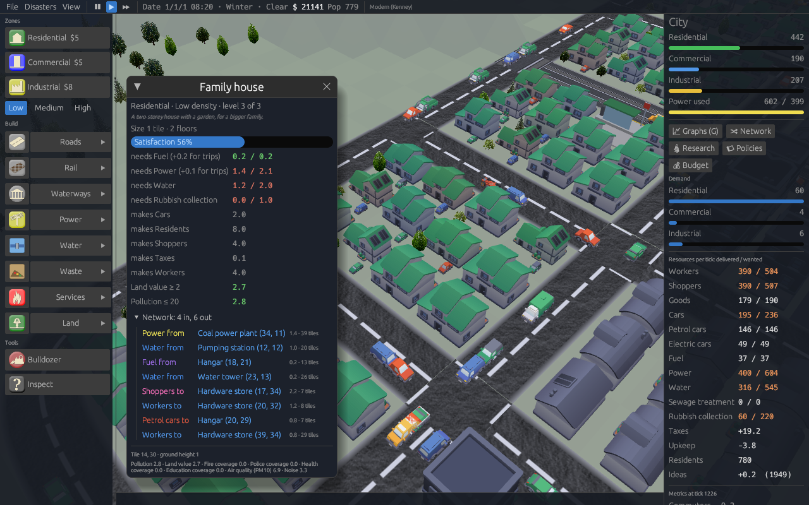

# Skins: re-dressing the city for an era or a world

A skin changes how the city looks and what things are called. It never
changes the simulation, so any skin works with any city or save file.

## Selection

0. **File > New city…** offers an **era** and, where several skins share it, a
   **culture** (for example Antiquity: Romans, Athenians, Gauls, Ptolemies, Han,
   Mauryas). The chosen skin dresses the new city.
1. `--skin <id>` (or **View > Skin** in the game) forces a skin; `--skin none` disables skins.
2. Otherwise the city's **world** is matched against each skin's `applies.worlds`.
   The world comes from the GeoJSON's top-level `world` (or `ofm:world`) member,
   or from `--world` on import. This is meant for OpenFantasyMap worlds.
3. Otherwise the city's **year** is matched against `applies.years`. The year
   is the `--date` of a historical import (OpenHistoryMap / OpenHistoricalMap).
4. Otherwise no skin is used: the classic OpenCity look.

Skins are tried in the order listed in `assets/skins/generated.toml` (written
by art bakes) and then `assets/skins/index.toml`. A skin's `era` and `culture`
keys group it in the new-city dialog.

## What a skin can change today

| Key | Effect |
|---|---|
| `look.sky`, `look.water` | Background and water colours |
| `look.tint`, `look.saturation` | Colour treatment of every model and of the terrain |
| `look.ui_accent`, `look.ui_panel` | egui interface colours |
| `look.vehicles` | Hide cars and the airliner over airports, e.g. before 1900 or in a fantasy world |
| `look.bridge_pier` | An `.obj` under `models/` (no extension) stood under bridges, two per tile over water, stretched from the bed to the deck; without it bridges rest on plain columns |
| `look.skybox` | An equirectangular sky image (path under the data directory) drawn behind the scene and lit by the hour and the weather; none keeps the plain `sky` colour. |
| `look.smoke` | `true` draws smoke over coal plants, incinerators and industry. |
| `[labels]` | Tool names, by tool id (`coal_plant = "Watermill"`) |
| `disabled_tools` | Tools that do not exist in that era or world |
| `[models]` | Graphic code to replacement model: `.ac` (AC3D), `.obj` (Wavefront, e.g. Kenney kits) or `.compose` (a model composed from parts, below). A path starting with `models/` is shared art under the data folder; any other path is relative to the skin folder |
| any file under the skin folder | Replaces the base file with the same relative path, e.g. `skins/fantasy/graphism/gui/road.png` |

Tool ids: `residential`, `commercial`, `industrial`, `road` (asphalt
street), `highway`, `paved_street`, `dirt_road`, `power_line`,
`coal_plant`, `nuclear_plant`, `fire_station`, `police`, `hospital`,
`school`, `park`, `trees`, `raise`, `lower`, `bulldozer`.

With GlassBox rules, a service tool is named after the unit the rules build
with it (a "Fortified granary" for `coal_plant` in the pre-industrial rules),
and the inspector names every building as the rules do. Rules can hide tools
too (`disabled_tools` in the rules file).

Replacement models keep the footprint of the model they replace, because the
simulation uses the base catalog's sizes. `.obj` models are scaled evenly to
fit that footprint, centred on it, and textured with the `colormap.png` next
to them.

## Composed models

A `.compose` file (TOML) builds a model from parts, so the buildings drawn
with it are not all alike. It lists **slots**; each slot has parts to pick
from (`""` is no part) and optionally colour tints. Every building gets one
combination, picked by its tile, so it keeps its look.

```toml
variants = 16                     # combinations used at most (default 12)

[[slot]]                          # the house, at the back of the plot
parts = ["../kenney/city-suburban/building-type-h.obj", "../kenney/city-suburban/building-type-e.obj"]
size = [0.82, 0.64]               # fitted evenly into this box, in tiles
at = [0.09, 0.0, 0.05]            # then moved by this much (x, y, z)
tints = [[1, 1, 1], [1.0, 0.93, 0.86], [0.9, 0.95, 1.0]]

[[slot]]                          # a tree in the front yard, or nothing
parts = ["", "../kenney/nature/tree_oak.obj"]
size = [0.24, 0.24]
at = [0.05, 0.0, 0.71]
rotations = [0, 90, 180, 270]     # turned about its centre; one is picked

[[slot]]                          # a chimney: a round part stood tall
parts = ["../kenney/factory/piston-round.obj"]
size = [0.3, 0.3]
height = 1.8                      # stretched upright to this, after the fit
at = [0.6, 0.0, 0.2]

[[slot]]                          # a Quaternius town house in one of two colourways
parts = ["../quaternius/town/2Story.obj"]
paints = [{ Main = [0.93, 0.86, 0.72], Bricks = [0.76, 0.62, 0.5] }, { Main = [0.56, 0.69, 0.85] }]
```

- **Paths** are relative to the `.compose` file.
- **Fitting:** a part with `size` is scaled evenly into that box. Without
  it, an `.obj` part fills the building's footprint and an `.ac` part keeps
  its own size, like whole models.
- **Front:** buildings face +z (the far end of the plot from the origin),
  where the street usually is.
- **Rotations:** `rotations` lists turns in degrees, one picked per variant
  like a part or a tint; the part turns about the centre of its box (or of
  the footprint) before `at` moves it. A single entry turns every variant
  the same way, which is how the power-line wires are strung north-south.
- **Height:** `height` stretches the part upright to that many tiles after
  the fit, so a square kit part can stand as a tower or a chimney.
- **Paints:** `paints` are colourways for `.obj` parts coloured by
  material (the Quaternius town houses): each gives some materials, by
  name, a new colour, and one is picked per variant like a tint. Parts
  without those materials (the colour-mapped Kenney kits) are unchanged,
  so a slot can mix both.
- **Variants:** with many combinations, `variants` of them are used.
  Variant `k` is combination `k × step` with `step` near 0.618 of their
  count and sharing no factor with it, so variants all differ and every
  part of a slot comes up before any repeats.
- A `.conf` next to the `.compose` file gives its name and size like any
  model's.



The modern skin draws its little houses (11) and family houses (12) this
way, from `models/composed/`: one of several Kenney houses, tinted, with a
tree and a parked car or neither. Its power lines, trees, parks, harbour,
seaport and water and waste works are compositions too
(`powerline_*.compose`, `tree_*.compose`, `park.compose`, `harbour.compose`,
`seaport.compose`, `pumping_station.compose`, `water_tower.compose`,
`water_treatment.compose`, `dump.compose`, `recycling.compose`,
`incinerator.compose`), and so are its services, power plants and transit
stops (`fire_station.compose`, `hospital.compose`, `nuclear_plant.compose`…).

## Shipped examples

* **modern** (Modern, Kenney city kits): years 1946 on, and every city with
  no date or world (`default = true` in `[applies]`). Houses come from the CC0
  Kenney City Kit Suburban, shops and towers from City Kit Commercial, and
  workshops, factories and the coal plant from City Kit Industrial. Power
  lines are City Kit Roads poles wired tile to tile, bridges stand on its
  pillars, trees and parks come from the Nature Kit, and the harbour and
  seaport are dressed with Watercraft Pack cargo and Factory Kit cranes.
  The services and the nuclear plant keep OpenCity's models. Some little,
  family and town houses, apartments (11-15, 17) and small shops (21-24)
  are a painted Quaternius town house instead, picked per plot
  (`mix_*.compose`). **View > Skin > None** brings back OpenCity's own
  buildings.

* **quaternius** (Town, Quaternius town houses): chosen from **View >
  Skin** (no years, not the default). Homes and shops are the CC0
  Quaternius Ultimate Textured Building Pack's town houses, painted in nine
  colourways per plot: cottages and town houses with yards, terraces,
  apartment houses, blocks round a courtyard and rows of tall houses, at
  the same scale on small and big plots (`q_*.compose`, written by
  `scripts/gen-quaternius.py`; the models are trimmed by
  `scripts/import-quaternius.py`). Works, services and networks are the
  modern skin's.

* **antiquity-<civ>** (baked, see below): years -1000 to 500, one per culture.
  Towns built from **0 A.D. art**: houses, storehouses, farmsteads, civic
  centres, barracks, fortress, wall towers, fields, mines and five tree species.
  Tools are named after the culture's own buildings (Domus, Oikos, Tegia, Mín Jū…).
* **antiquity**: the same era without 3D art, used when nothing is baked.
  Paved roads (*via strata*) and tracks instead of asphalt.
* **medieval**: years 501 to 1449. Muted palette, no vehicles, no
  electricity; cobbled streets and dirt lanes. Homes, shops, services,
  amenities and the fields and crafts are built from the Quaternius
  Medieval Village MegaKit (below).
* **renaissance**: years 1450 to 1799. Faded warm palette, no vehicles, no
  nuclear plant, cobbled streets and lanes. With the classic rules the coal
  plant becomes a "Watermill" and power lines become a "Mill race".
* **industrial**: 1800-1945. Grey skies, coal age names, no nuclear plant,
  no highways.
* **fantasy**: worlds `Eldoria`, `*fantasy*`, `ofm:*`. Vivid palette, magic
  vocabulary ("Mage tower", "Ley line", "Dragon forge"), no vehicles, no
  highways. Its buildings are the medieval skin's, in vivid colours, with
  mage towers, a dragon forge, standing stones and ley lines of its own.

Except for antiquity, medieval and fantasy, these reuse OpenCity's
modern-looking models, so they are a mood change, not a full reskin.

## Medieval village buildings

The medieval and fantasy skins draw their homes and shops (11-19, 21-29)
with buildings put together from the CC0 **Quaternius Medieval Village
MegaKit**. The kit is modular, not whole houses: 2 m wall panels with doors
and windows, corner posts, jettied storeys, roofs sized to the walls, gables,
dormers, chimneys, balconies, awnings and props. Two scripts make the
buildings and the plots:

```sh
python3 -I scripts/build-medieval.py "/path/to/Medieval Village MegaKit[Standard]" \
    --ruins "/path/to/Ultimate Modular Ruins Pack - Aug 2021" --kenney /path/to/kenney_fantasy-town-kit_2.0
python3 -I scripts/gen-medieval.py
```

1. **`build-medieval.py`** puts the pieces together on the kit's grid
   (walls 2 m wide on lines facing out, 3 m storeys, a roof over each box of
   walls) into one trimmed `.obj` + `.mtl` per building in
   `assets/models/quaternius/medieval/`, door to +z like every citysim
   building: one-storey cottages (`cottage_timber`, `cottage_stone`,
   `cottage_wide`, `cottage_long`), two-storey houses with a storey jettied
   over the street or a stone ground floor (`house_jetty`, `house_stone`,
   `house_wide`), three-storey town houses (`townhouse_narrow`,
   `townhouse_wide`), a `longhouse`, a `tower`, shops under an arcade or an
   awning (`shop_arcade`, `shop_corner`), a market `stall`, a `tavern`, an
   `inn`, a `guildhall`, and yard props (`prop_wagon`, `prop_crates`,
   `prop_fence`). The kit's textured trim sheets become flat colours, one per
   material: `Plaster`, `Timber`, `Stone`, `Stonework` (rubble walls),
   `Tiles`, `Shingles` (wooden roofs, awnings and stalls), `Paintwork` (doors
   and shutters), `Glass`, `Iron`. Faces nobody sees from above (the inside
   of the walls, undersides) are left out, and glazing bars are dropped.
2. **`gen-medieval.py`** writes the compositions `med_11` ... `med_29`
   (medieval) and `fan_11` ... `fan_29` (fantasy) in `assets/models/composed/`.
   Every building keeps the kit's scale (10.5 m to a tile) on any plot: a
   slot's parts share a width, so `size` fits them all alike. Small plots hold
   a house, with a yard, a tree, a wagon or crates beside it; big ones are
   quarters: two houses back to back (16), a farmstead round its yard (18), a
   row of tall houses and a tower (19), market stalls (21), shops and a stall
   (24), a market square with its guild hall, tavern and tower (25), a tavern
   or an inn with its yard (26, 27), a guild hall with houses behind it (28)
   and a guild quarter (29). The `paints` repaint `Plaster`, `Timber`,
   `Tiles`, `Stonework`, `Paintwork` and `Shingles` in nine colourways per
   skin: lime, ochre and pinkish walls under red, brown or slate roofs for the
   medieval skin; lilac, mint, sky-blue and rose walls under blue, purple,
   teal or gold roofs for the fantasy skin.

### Services, works and the fields and crafts

Every other building either skin can show is made the same way, at the same
scale, on the footprint of the OpenCity model it replaces (`med_<code>` and
`fan_<code>`). `build-medieval.py` also assembles a church with its tower
and spire, a chapel, a turret, a mage tower, a tithe barn, a market hall on
open arches, an infirmary, a college range, a gatehouse, a galleried
playhouse, a smithy, a forge hall, a brewhouse, a mill tower and a mill
house; windows on these big buildings are plain panes. Simple shapes made
by the script fill the rest: furrowed fields, haystacks, a well, a
fountain, ponds, a mill race, reed beds, middens, a lime kiln, log piles,
dye vats, a landing stage, a stone quay, a treadwheel crane, tournament
stands and the tilt, tents, a maypole, standing stones, waystones and ley
lines. Statues, columns and ruins come from the CC0 **Quaternius Ultimate
Modular Ruins Pack**; windmill sails, a water wheel, market stalls, carts,
lanterns, hedges, rocks and the fantasy trees from the CC0 **Kenney Fantasy
Town Kit** (`assets/models/kenney/fantasy-town/`, copied with `--kenney`).
New materials take the per-plot `paints` too: `Banner` (cloth of banners,
tents and stands), `Crop` (the fields) and `Glow` (fires; magic in the
fantasy skin).

| Code | Medieval | Fantasy |
|---|---|---|
| 31 | Field: a ploughed field | the same |
| 32 | Smithy | the same |
| 33 | Dye works by a mill race | the same |
| 34 | Timber yard and saw pit | the same |
| 35 | Brewhouse | the same |
| 36 | Windmill | the same |
| 37 | Watermill on its race | the same |
| 38 | Croft: cottage, field, haystacks | the same |
| 39 | Manor farm: fields, great barn, windmill | the same |
| 300 | Tithe barn and its yard | Mage tower in a ring of standing stones |
| 303, 304, 305, 306 | (not built) | Dragon forge, Sun circle, Arcane foundry, Windmill |
| 320 | Well | Sacred grove |
| 330-334 | Kenney Nature Kit trees | Kenney Fantasy Town Kit trees |
| 340 | Tournament lists | Jousting lists |
| 341 | Market hall with stalls and shops | Grand bazaar |
| 342 | Reliquary: chapel and statues in a walled garden | Hall of relics |
| 343 | Painters' guild | Enchanters' gallery |
| 344 | Playhouse | Bards' playhouse |
| 345 | Old ruins | Ancient ruins |
| 346, 347, 348 | (not built) | Elven retreat, Stargazer's tower, Faire |
| 350 | Watch: tower, guardhouse, well | Water elementalists (with a fountain) |
| 351 | Magistrate's house | Lord's manor |
| 352 | Town hall over an open market, with a belfry | Council hall |
| 353 | Ward house | the same |
| 360 | Town guard: gatehouse and walled yard | Guard house |
| 370 | Hospital of St John: infirmaries, chapel, herb garden | Temple of healing |
| 376, 377, 378 | (not built) | Water garden, Culvert, Reed bed |
| 380 | Conduit house and cistern | Spring house |
| 381 | Cistern tower | the same |
| 382 | Settling ponds | Purifying pools |
| 383 | Midden | the same |
| 384 | Rag-and-bone yard | Tinkers' yard |
| 385 | Lime kiln | Salamander kiln |
| 386, 387, 388 | Waystone, Horse post, Undercroft | Waystone, Coach post, Delvers' stair |
| 390 | Cathedral school: church and school | Academy of magic: mage tower and school |
| 391 | Grammar school | Hall of apprentices |
| 392 | College: a quadrangle and a chapel | Arcane university |
| 393 | University: two courts, church, gatehouse | Arcane university |
| 396 | Quay: landing stage and boat shed | the same |
| 397 | Carriers' yard: stables and wagons | Griffin roost |
| 398 | Port: stone quay, treadwheel cranes, warehouse | the same |
| 170-184 | (no power lines) | Ley line: standing stones and a glowing line |

The tools are named after them (`[labels]` in each `skin.toml`). A skin
that replaces the wind turbine's model (with a windmill) also stops the
turbine blades the game draws on OpenCity's own model.

## 0 A.D. art (antiquity skins)

The 0 A.D. models are CC BY-SA 3.0, so they are not committed or packaged.
They are converted from the **original 0 A.D. repository**
(`gitea.wildfiregames.com/0ad/0ad`, pinned commit in
[`assets/zeroad/antiquity.toml`](../assets/zeroad/antiquity.toml)) by citysim
itself. No Docker, git or Python is needed:

```sh
opencity-cli bake-0ad          # any install; --from <0 A.D. checkout> works offline
./download-0ad-art.sh          # release package: .sh on Linux, .command on macOS
download-0ad-art.cmd           # release package on Windows
scripts/bake-0ad.sh            # source checkout (cargo run)
```

The game also runs it in the background on first launch, then the cultures
appear in **File > New city…**. `--bake-0ad` forces a new run and
`--no-auto-bake` disables it. The attempt is recorded in
`assets/skins/.bake-0ad-attempted`.

The bake ([`crates/opencity-zeroad`](../crates/opencity-zeroad)) runs in four steps:

1. **Read the data.** It reads simulation templates (with inheritance and
   mixins), civilisation names, actors and variants. The XML files come one
   by one from the repository's `raw` endpoint.
2. **List the needs.** It collects the meshes and textures that the mapped
   structures, trees and props use.
3. **Download.** It fetches only those, about 380 Git LFS files or 115 MB,
   from the `media` endpoint, eight at a time. Downloads are cached in
   `~/.cache/citysim/0ad` (`%LOCALAPPDATA%\citysim\0ad` on Windows), so a
   second run is fast.
4. **Convert.**
   * COLLADA meshes become Y-up AC3D with props attached at their prop
     points, scaled to the footprint of the OpenCity model they replace.
   * PNG/DDS textures get the culture's player colour.
   * Per culture it writes `models.toml`, `skin.toml` (tools named after the
     culture's own buildings) and `ATTRIBUTION.txt` into
     `assets/skins/antiquity-<civ>/`, and lists them in `assets/skins/generated.toml`.

Without the baked art, the plain antiquity skin still applies its colours,
names and rules.

## Assessment: what a full reskin needs

**The bottleneck is 3D content, not code.** One complete era or world set
needs about 60 models:

* 10 levels for each of residential, commercial and industrial, so 30 models.
* 15 road pieces.
* Power plants, the four services, a park and 3 to 5 trees.

The rest of the pipeline (selection, overrides, colour, names, rules) is in
place. Ways to get there, roughly by effort:

1. **More 0 A.D. cultures.** Adding a culture is one line in
   `assets/zeroad/antiquity.toml`. Medieval and
   later eras need other sources.
2. **CC0 kits through `.obj`.** The OBJ loader is in place, and the modern
   skin maps three Kenney city kits onto the graphic codes this way. Kenney's
   town, castle and fantasy kits would give a medieval or fantasy look the
   same way.
3. **Procedural buildings from map tags.** OHM and OSM buildings carry
   `building:levels`, `roof:shape`, `building:material`, `building:colour`
   and `start_date`. A generator could extrude footprints with era-appropriate
   roofs and materials. Imported cities would then look like their source,
   not like generic zone models. It is more work, but it scales to any era
   and fits OHM data especially well.
4. **World styles from OpenFantasyMap.** OFM worlds already carry styling
   (georender rulesets). A converter could derive `look` colours and terrain
   palettes from a world's ruleset, so each world gets a matching skin
   automatically. This needs an OFM world/ruleset endpoint or export, which is
   not available to this project yet.
5. **Era rules (optional).** If eras should also play differently, add a
   rules overlay per skin: costs, growth ranges, and what "power" means
   (water mills before 1880). It is a small, separate change in
   `opencity-core`, kept out of skins on purpose so saves stay compatible.
6. **Living history.** Imported cities could start their calendar at the
   import year. Crossing an era boundary would then switch the skin, and
   newly available tools would unlock, so a city plays through history.

Fonts, terrain textures per biome, road textures (the antiquity skin still
has modern asphalt), and sound packs fit the same override mechanism and can
be added as needed.
